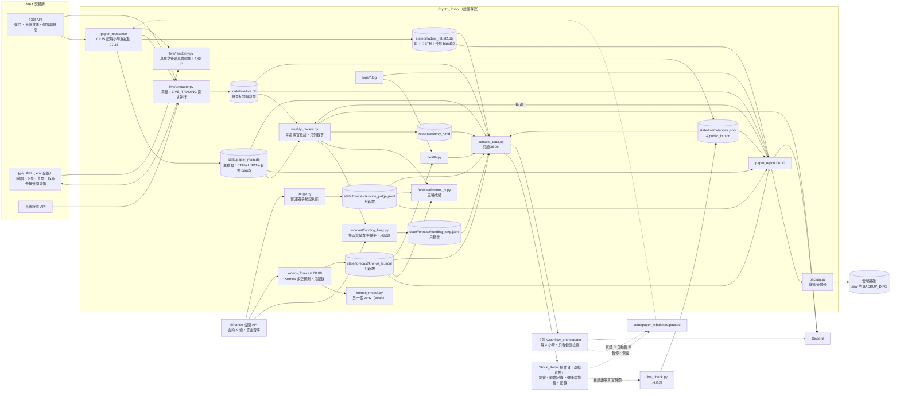
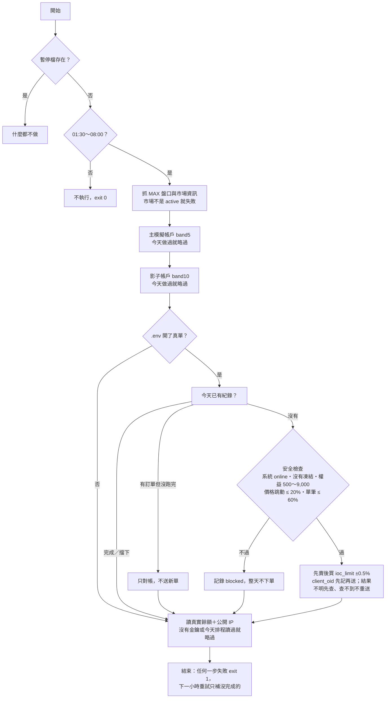
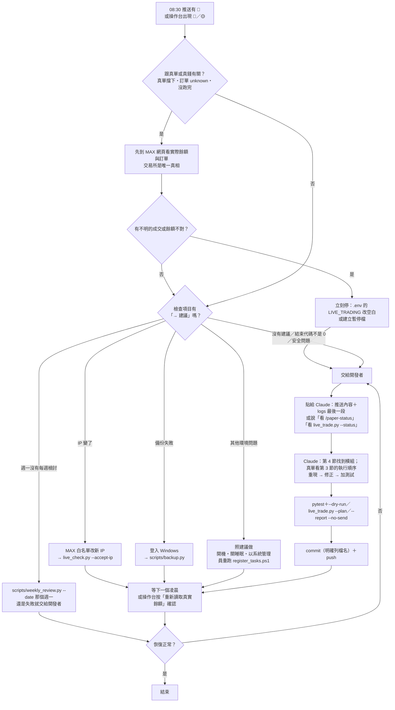

# 系統架構與維運手冊

給「營運者（你）與開發者（Claude）」看：每個 Agent 做什麼、用哪些檔案、出錯時誰處理、先看哪裡。
規則與決策的來龍去脈在 `docs/DESIGN.md`；這份只講「現在怎麼運作」。**改了架構（新增 Agent、搬檔案、改排程）時同步更新這份。**

## 快速索引（先看這裡，再跳到對應章節）

| 症狀／想做的事 | 先看 | 章節 |
|---|---|---|
| 08:30 推了 🔴「01:30～08:00 都沒有成功」 | `logs\paper_rebalance.log` 最後一段；操作台「虛擬貨幣」→ Agent 健康 | 5 |
| 08:30 沒收到推送 | 操作台「虛擬貨幣」→ 排程 `paper_report`、`logs\paper_report.log`、`.env` 的 webhook | 5 |
| 操作台燈號 🟡／🔴 | 該項檢查的「→」建議；檢查邏輯在 `src/crypto_robot/health.py` | 5 |
| 帳戶數字怪（成交價、比例、權益） | `paper_rebalance.py --status`、`state\paper_main.db`、`paper/multi_account.py`、`paper/fills.py` | 4、6 |
| 備份失敗 | `scripts/backup.py`、`src/crypto_robot/backup.py`、`state\backup\last.json`、`.env` 的 `BACKUP_DIRS` | 7 |
| 真單擋下、沒跑完、訂單 unknown | `scripts/live_trade.py --status`／`--plan`、`live/executor.py`、`state\live\live.db` | 4、5 |
| 真實帳戶（唯讀）讀不到、IP 變了 | `scripts/live_check.py`（手動讀、`--accept-ip`）、`live/readonly.py`、`state\live\` | 4、5 |
| 每週檢討沒推、數字怪 | `scripts/weekly_review.py --no-send`、`src/crypto_robot/weekly.py`、`reports\weekly_*.md` | 4 |
| 影子帳戶（兩資產）怪 | `state\shadow_rebal2.db`、`paper/multi_account.py`；設定在 `paper_rebalance.py` 的 `SHADOW` | 4 |
| 想改規則參數、資金、排程時間、通知內容 | `CLAUDE.md` 的「要改什麼，改哪裡」 | 6 |
| 操作台分頁壞掉 | `scripts/console_data.py`（資料；前瞻紀錄是 `forecast_data()`）；Stock_Robot `src/web/console.py` 的 `/api/crypto`、`templates/console.html` 的 `loadCrypto`（四個子分頁：總覽、前瞻紀錄、健康與排程、紀錄） | 2、6 |
| MAX API 回應改了 | `exchange/max/public.py`；端點查核在 DESIGN.md 第 1 節 | 2 |
| 新研究 | `/research-round` skill；研究結果在 DESIGN.md 6.3 | — |
| 主管自動暫停了虛擬貨幣、Discord 收到診斷報告 | `../Cashflow_orchestrator` 的 `scripts/supervise.py --status`、`reports/diagnosis/`；恢復＝營運者刪暫停檔 | 1、5 |

改完一律：`pytest -q` → `paper_rebalance.py --dry-run --ignore-window` 或 `--report --no-send` → commit → push（`/ship`）。

- [1. 角色分工](#1-角色分工)
- [2. 系統總覽](#2-系統總覽)
- [3. 每日時間軸](#3-每日時間軸)
- [4. Agent 責任表](#4-agent-責任表)
- [5. 出錯時的處理流程](#5-出錯時的處理流程)
- [6. 想改功能要改哪裡](#6-想改功能要改哪裡)
- [7. 狀態檔地圖](#7-狀態檔地圖)
- [8. 安全邊界](#8-安全邊界)

---

## 1. 角色分工

| 角色 | 誰 | 負責 |
|---|---|---|
| 營運者 | 你 | 決定規則、資金、交易時段；看 08:30 推送與操作台；處理有明確建議的 🔴（開機、重跑排程、以系統管理員重新註冊排程）；決定何時接真單 |
| 開發者 | Claude（在 Crypto_Robot 資料夾） | 改程式、診斷「不是已知狀況」的錯誤、加 Agent 與健康檢查、維護測試與文件 |
| Agent | 3 個排程（第 4 節） | 每天自動執行；已知狀況自己處理（同一天不重複交易、差額太小不下單、盤口不足只部分成交） |
| 監控 | `src/crypto_robot/health.py` | 開操作台分頁時檢查「有沒有達到預期」；凌晨失敗先由 Agent 每小時重試，整個時段都失敗才由 08:30 報告推 🔴 |
| 主管 | `../Cashflow_orchestrator`（另一個 repo，每 3 小時） | 讀 `console_data.py` 的健康檢查：真單訂單 rejected／unknown、送單沒跑完 → 自動建立暫停檔＋推送；不是已知狀況的 🔴 → 叫醒 Claude 唯讀診斷。不改程式、不下單、不恢復 |

**誰處理什麼**

| 狀況 | 例子 | 誰處理 |
|---|---|---|
| 🟡 只需留意 | 重試後才成功、還在重試中、最近 7 天漏跑一天、差額太小不調整、盤口深度不足只部分成交、已暫停 | 不用處理；常發生再找開發者 |
| 🔴 有明確建議 | 整個 01:30～08:00 電腦都關機或睡眠、`paper_report` 排程沒建立、`.env` 沒填 webhook | 你：照「→」建議做 |
| 🔴 不是已知狀況 | 7 次重試都失敗且有錯誤訊息、新的錯誤訊息 | 開發者：把 08:30 推送或 `logs\*.log` 最後一段貼給 Claude |
| 🔴 安全 | `.env` 被 git 追蹤、紀錄檔出現 webhook | 開發者立刻處理；你到 Discord 重新產生 webhook |
| 改規則、加功能、接真單 | 改目標比例、改資金、加新 Agent | 你決定 → 開發者實作、測試、更新文件 |

---

## 2. 系統總覽

- 模擬帳戶只用公開 API：用當下盤口逐檔吃單、扣 taker 0.16%。
- 真單用 `.env` 的 MAX 金鑰（查詢＋交易，**沒開提領**）。只有 `live/executor.py` 用會下單的 `MaxTradingClient`；其他讀取一律用沒有交易方法的 `MaxPrivateClient`。
- 操作台用 Crypto_Robot 自己的 Python 執行 `console_data.py`（只讀）與 `live_check.py`（只查詢），兩個專案不互相 import。
- 研究工具（`lab/`、`scripts/research.py`、`scripts/fetch_bars.py`）是手動用，不在排程裡。

---

## 3. 每日時間軸

| 台北時間 | 排程（`\crypto_robot\`） | 做什麼 | 推送 |
|---|---|---|---|
| 00:00 | `kronos_forecast` | 抓 Binance 合約 1h K 線與資金費率 → Kronos 預測接下來 24 小時（只記錄不下單，DESIGN 6.7）；08:00 後補跑就略過 | 不推送（08:30 報告多一行） |
| 01:30～08:00 | — | 使用者允許自動交易的時段（2026-10-26 由 07:30 延長） | — |
| 01:35、02:35…07:35 | `paper_rebalance` | 主模擬 → 影子 → 真單 → 讀真實餘額（下圖）；每一步同一天只做一次，已完成的在重試時略過 | 不推送 |
| 08:30 | `paper_report` | 推送真單、真實餘額、Kronos 預測（模擬、影子帳戶的結果只寫進 `logspaper_report.log`，2026-11-02 起不推送）；**每週一**再推一則每週事實檢討；最後備份 | Discord |
| 00:10、03:10…21:10 | 主管 `\cashflow_orchestrator\`（另一個 repo） | 收集健康檢查；真錢 🔴 建立暫停檔，不是已知狀況的 🔴 叫醒 Claude 唯讀診斷 | 真錢或不是已知狀況的新 🔴 才推；已知 🔴 超過 12 小時沒解決再提醒一次 |
| 隨時 | — | 操作台「虛擬貨幣」分頁（子分頁：總覽、前瞻紀錄、健康與排程、紀錄）：每分鐘自動刷新畫面；「重新讀取真實餘額」按鈕只查詢；前瞻紀錄只讀紀錄檔與本機 K 線，不連網 | 不推送 |

**01:35 一次執行的順序**（`scripts/paper_rebalance.py` 的 `run()`；順序有意義：讀餘額要在真單之後，快照才是交易後的狀態）

排程用 S4U（不用登入 Windows），會把電腦從睡眠喚醒；某一次失敗（網路、MAX 維護、還沒喚醒）由下一小時的重試補上；整個時段電腦都關機才會漏跑，開機後補跑但過了 08:00 會自己略過。
08:30 的備份寫到雲端硬碟，雲端硬碟電腦版要登入 Windows 才會掛上。

---

## 4. Agent 責任表

| Agent | 進入點 | 用到的程式 | 讀 | 寫 | 已知狀況自己處理 | 健康檢查 |
|---|---|---|---|---|---|---|
| 模擬再平衡 | `scripts/run_scheduled.cmd paper_rebalance` → `paper_rebalance.py` | `paper/multi_account.py`、`paper/fills.py`、`agents/strategy/rebalance_multi.py`、`exchange/max/public.py` | MAX 公開 API（ethtwd、usdttwd）、`state/paper_main.db`、暫停檔（主帳戶 band5） | db、`logs\paper_rebalance.log` | 失敗每小時重試到 07:35、時段外不動作、同一天不重複、低於最低下單量不調整、深度不足只部分成交（記在備註） | 今天凌晨有執行（重試中／重試後成功為 🟡）、最近 7 天沒漏跑、上次結束代碼 0、備註 |
| 早上報告 | `run_scheduled.cmd paper_report paper_rebalance --report` | `paper_rebalance.py` 的 `push_text`（只推真單、真實帳戶、Kronos；模擬帳戶的 `morning_text` 只寫紀錄）、`notify/discord.py` | db、`logs\paper_rebalance.log`、`.env` | Discord、`logs\paper_report.log` | Discord 失敗只寫紀錄，不中斷 | webhook 已設定、今天 08:25 後有執行且結束代碼 0 |
| 影子帳戶：兩資產（同一個排程） | `paper_rebalance.py` 在主帳戶之後執行 | `paper/multi_account.py`、`agents/strategy/rebalance_multi.py` | MAX 公開 API（ethtwd）、`state/shadow_rebal2.db` | `state/shadow_rebal2.db` | 失敗不影響主帳戶，回傳結束代碼 1 讓下一小時重試；同一天不重複 | 和主帳戶相同的「今天凌晨執行」等檢查 |
| 真單（同一個排程，`.env` 開啟才執行） | `paper_rebalance.py` 在影子帳戶之後、讀真實餘額之前執行（`live_trade.py` 只有 `--plan`／`--status`，不能手動下單） | `live/executor.py`、`exchange/max/private.py` 的 `MaxTradingClient` | MAX 私有 API、`.env`（LIVE_TRADING、LIVE_CONFIRM、LIVE_CAPITAL_CAP） | `state/live/live.db` | 安全檢查不過就整天不下單；同一天只做一次；結果不明不重送 | 今天有執行、沒被擋下、沒有 rejected／unknown 訂單 |
| 真實帳戶（唯讀，同一個排程） | `paper_rebalance.py` 在真單之後執行（快照才是交易後的狀態）；操作台「重新讀取真實餘額」按鈕會呼叫 `live_check.py` | `live/readonly.py`、`exchange/max/private.py` 的 `MaxPrivateClient`（只有查詢方法） | `.env` 的 MAX 金鑰、MAX 私有 API、公開 IP | `state/live/balances.jsonl` | 排程一天讀一次（按鈕可手動再讀）；失敗只記錄，不影響模擬帳戶 | 今天凌晨有讀到、公開 IP 和白名單相同、讀取成功 |
| 備份（`paper_report` 推送後） | `paper_rebalance.py --report` → `scripts/backup.py` | `src/crypto_robot/backup.py` | `state/`、`reports/`（不含 `.env`） | `BACKUP_DIRS` 的壓縮檔（保留 40 份）、`state/backup/last.json` | 一個目的地失敗不影響其他；SQLite 先做一致快照再壓縮 | 每個目的地成功、3 天內有備份 |
| 每週事實檢討（`paper_report` 每週一，備份之前） | `paper_rebalance.py --report` → `scripts/weekly_review.py`（也可手動 `--no-send`／`--date`） | `src/crypto_robot/weekly.py`（純函式） | `state/live/live.db`、`state/paper_main.db` | `reports/weekly_YYYYMMDD.md`、Discord | 只列數字、不給建議；失敗不影響備份 | 最近一個週一（2026-11-02 起）有產生 |
| 幣安資金費率做多前瞻紀錄（每週檢討的最後一段，2026-11-02 起） | `weekly_review.py` 先跑 `fetch_binance.py --futures` 再補記（`--no-send` 不抓不寫） | `src/crypto_robot/forecast/funding_long.py`（規則借用 `lab/futures.py`） | Binance 公開 API（不需要金鑰） | `state/forecast/funding_long.jsonl`、週報最後一段 | 只記錄不下單；失敗只在週報印一行，不影響週報與備份 | 週報最後一段有筆數，沒有「失敗」字樣 |
| Kronos＋人工判斷多空前瞻紀錄（2026-11-03 起） | `run_scheduled.cmd kronos_forecast` → `kronos_forecast.py`；營運者手動 `judge.py long\|short\|flat` | `forecast/kronos_ls.py`（純函式）、`kronos_model.py`（`../_vendor/kronos_venv`，Kronos commit 67b630e） | Binance 公開 API、`data/bars.db` | `state/forecast/kronos_ls.jsonl`、`kronos_judge.jsonl`、`logs\kronos_forecast.log`；08:30 報告一行、週報一段 | 只記錄不下單；已預測過、08:00 後就略過；判斷一天一次、不能改 | 08:30 報告沒有「今天 00:00 沒有預測」；`health.py` 的 `check_kronos`：08:00 後看今天有沒有預測（漏 1～2 天 🟡、連續 3 天以上 🔴；主管當已知狀況，不會自動暫停） |
| 系統與安全（不是排程） | 操作台開分頁時 | `health.py` 的 `check_system` | git、logs、考卷檔、K 線快取 | — | — | `.env` 沒進 git、專案資料夾沒有金鑰檔、紀錄檔沒有 webhook；考卷期與 K 線快取只顯示資訊 |

---

## 5. 出錯時的處理流程

**診斷時先看哪裡**

| 要查 | 位置 |
|---|---|
| 這次執行印了什麼 | `logs\paper_rebalance.log`、`logs\paper_report.log`（每次以 `=====` 開頭、`----- exit N` 結尾）；操作台「排程紀錄」 |
| 帳戶與每天的動作 | `paper_rebalance.py --status`；操作台「每日紀錄」「交易紀錄」 |
| 排程有沒有跑、結束代碼 | 操作台「虛擬貨幣」→ 排程；或 `/paper-status` |
| 全部一次看完 | `/paper-status` skill（只讀） |

**已知狀況與建議**

| 現象 | 原因 | 建議 |
|---|---|---|
| 「重試後成功」「尚未成功，每小時會重試」 | 某幾次網路或 MAX 暫時失敗 | 不用處理；同樣原因常發生再交給開發者 |
| 「整個 01:30～08:00 都沒有成功（沒有執行紀錄）」 | 整個時段電腦關機、睡眠沒被喚醒，或排程停用 | 確認電腦開著、電源設定允許喚醒；排程被停用就重新註冊 |
| 「整個 01:30～08:00 都沒有成功：…執行失敗（錯誤）」 | 7 次都遇到同一個錯誤 | 交給開發者 |
| 「08:30 沒有執行」 | `paper_report` 排程不存在或停用 | 以系統管理員重跑 `scripts\register_tasks.ps1` |
| 「差額低於交易所最低下單量」 | 帳戶小、偏離剛過門檻 | 不用處理 |
| 「盤口深度不足，只部分成交」 | 凌晨掛單少 | 不用處理；常發生再討論 |
| 結束代碼不是 0、出現 Traceback | 程式或 MAX API 回應改變 | 交給開發者 |
| 真單「安全檢查擋下」 | 系統維護、有掛單凍結、超過階段上限或權益 < 500、價格跳動 > 20%、單筆 > 60% | 依原因處理；擋下時帳戶不會動。要加碼先調高 `LIVE_CAPITAL_CAP` |
| 真單訂單 unknown | 送出後網路中斷，查不到結果 | 到 MAX 網頁確認有沒有成交，再交給開發者 |
| 「公開 IP 和白名單不同」「讀取失敗：HTTP 403」（2026-10-28 實際遇到；金鑰錯誤多半是 401） | 家用網路 IP 變了，金鑰被 MAX 白名單擋下 | 到 MAX 的 API 金鑰頁面把白名單改成新 IP，再執行 `scripts\live_check.py --accept-ip` |
| 「備份失敗」🔴 | 雲端硬碟沒有掛上（還沒登入 Windows）或資料夾不存在 | 登入 Windows 後執行 `scripts\backup.py` |
| 「專案資料夾沒有金鑰檔」🔴 | 有人把金鑰另存成文字檔放在專案資料夾 | 金鑰只放 `.env`，刪掉那個檔案 |
| 「現在不在 01:30～08:00 交易時段」 | 排程時間被改或補跑太晚 | 檢查排程時間 |

---

## 6. 想改功能要改哪裡

見 `CLAUDE.md` 的「要改什麼，改哪裡」（每次對話都會自動載入，這裡不重複）。新增 Agent 的步驟：

1. 寫 `scripts/<名稱>.py`（加 `--dry-run`），在 `register_tasks.ps1` 的 `$tasks` 加一列；
2. 在 `health.py` 加它的檢查、在 `console_data.py` 的 `agents` 加一列；
3. 更新本文件第 3、4 節與 `CLAUDE.md`；請營運者以系統管理員重跑 `register_tasks.ps1`。

---

## 7. 狀態檔地圖

| 檔案 | 內容 | 能不能重建 |
|---|---|---|
| `state/paper_main.db` | 主模擬帳戶（三資產）的帳戶、交易、每日快照 | **不能**（前瞻紀錄） |
| `state/shadow_rebal2.db` | 影子帳戶（兩資產）的帳戶、交易、每日快照 | **不能**（前瞻紀錄） |
| `state/live/live.db` | 真單每天的執行紀錄與訂單 | **不能**（交易紀錄；實際以 MAX 帳戶為準） |
| `state/live/balances.jsonl`、`state/live/public_ip.json` | 真實帳戶（唯讀）每日紀錄、白名單 IP（含公開 IP，只在本機） | 能（重新讀）；IP 用 `live_check.py --accept-ip` 重設 |
| `state/paper_rebalance.db` | 2026-10-26 以前的兩資產主帳戶（已轉到 paper_main.db），只留作紀錄 | 不再寫入 |
| `state/research/holdout.json` | 考卷期結果（只考一次） | **不能** |
| `state/forecast/funding_long.jsonl` | 幣安資金費率做多的前瞻紀錄（2026-11-02 起，每週一補記，只新增；DESIGN 6.7） | 能從幣安公開資料重算，但紀錄本身是前瞻證據，不要刪 |
| `state/forecast/kronos_ls.jsonl`、`kronos_judge.jsonl` | Kronos 每天 00:00 的多空預測、營運者的判斷（2026-11-03 起，只新增；DESIGN 6.7） | 判斷無法重建，紀錄是前瞻證據，不要刪；備份會帶到 |
| `state/paper_rebalance.paused` | 有這個檔案就暫停；主管（`../Cashflow_orchestrator`）遇到真單訂單 unknown／rejected、送單沒跑完會自動建立 | 刪掉＝恢復（由營運者決定） |
| `data/bars.db`、`data/funding_ethusdt.json` | K 線快取（MAX ethtwd／btctwd／usdttwd、Binance 現貨與 ETHUSDT 合約 1h）、幣安資金費率；研究與前瞻紀錄用 | 能（`fetch_bars.py`、`fetch_binance.py` 重抓） |
| `logs/*.log` | 排程輸出 | 可刪 |
| `reports/research_*.md` | 研究報告 | 能（`research.py` 重跑） |
| `reports/weekly_*.md` | 每週事實檢討 | 能（`weekly_review.py --date` 重算） |
| `.env` | Discord webhook、MAX 金鑰、真單開關與上限、`BACKUP_DIRS` | 自己保管（等同密碼） |

`state/`、`data/`、`logs/`、`reports/`、`.env` 都不進 git。**備份**：每天 08:30 報告推送後，把 `state/` 與 `reports/` 壓縮到 `.env` 的 `BACKUP_DIRS`（保留 40 份，不含 `.env`）。
雲端硬碟電腦版要登入 Windows 才會掛上磁碟機；沒登入時備份會失敗、健康檢查亮 🔴，登入後執行 `scripts\backup.py` 補一次。
**還原**：停用排程 → 把最新的壓縮檔解開到專案資料夾（覆蓋 `state/`、`reports/`）→ `.env` 自己另外保管 → `paper_rebalance.py --status`、`live_trade.py --status` 確認 → 恢復排程。真單以 MAX 實際餘額為準。

---

## 8. 安全邊界

- MAX 金鑰開了查詢＋交易、**沒開提領**（營運者 2026-10-26 確認）。下單只在 `.env` 開啟真單時由 `live/executor.py` 進行，程式沒有任何提領方法。
- 金鑰只放 `.env`；commit 一律明確列出檔名，內容不能有金鑰、webhook、公開 IP 或其他個資。
- repo 是公開的：`.env`、`state/` 等不進 git；健康檢查會抓 `.env` 被追蹤、紀錄檔出現 webhook。
- 操作台只聽 127.0.0.1（手機經 Tailscale），虛擬貨幣分頁只讀，唯一會寫的是暫停檔。
- 自動交易只在台北時間 01:30～08:00。
- 研究：先訂標準再看結果；ETH 研究期 2021–2023 已看過六次以上、考卷期已在第三輪用掉（之後跑 2024 起的資料只當參考）；山寨幣與 BTC 2024-07 起的考卷期還沒用過。
- 主管（`../Cashflow_orchestrator`）唯一會自己做的動作是建立暫停檔；恢復由營運者決定。
