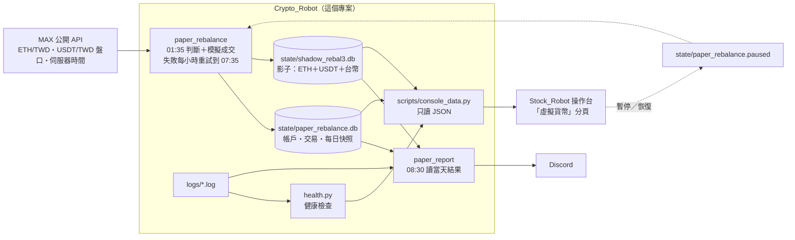
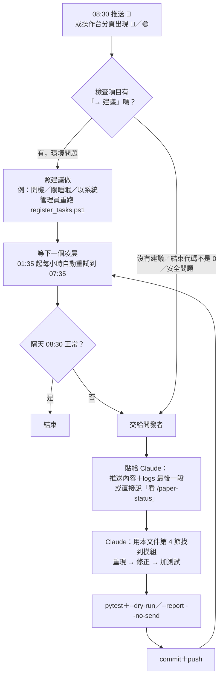

# 系統架構與維運手冊

給「營運者（你）與開發者（Claude）」看：每個 Agent 做什麼、用哪些檔案、出錯時誰處理、先看哪裡。
規則與決策的來龍去脈在 `docs/DESIGN.md`；這份只講「現在怎麼運作」。**改了架構（新增 Agent、搬檔案、改排程）時同步更新這份。**

## 快速索引（先看這裡，再跳到對應章節）

| 症狀／想做的事 | 先看 | 章節 |
|---|---|---|
| 08:30 推了 🔴「01:30～08:00 都沒有成功」 | `logs\paper_rebalance.log` 最後一段；操作台「虛擬貨幣」→ Agent 健康 | 5 |
| 08:30 沒收到推送 | 操作台「虛擬貨幣」→ 排程 `paper_report`、`logs\paper_report.log`、`.env` 的 webhook | 5 |
| 操作台燈號 🟡／🔴 | 該項檢查的「→」建議；檢查邏輯在 `src/crypto_robot/health.py` | 5 |
| 帳戶數字怪（成交價、比例、權益） | `state\paper_rebalance.db`（`--status`）、`paper/rebalance_account.py`、`paper/fills.py` | 4、6 |
| 影子帳戶（三資產）怪 | `state\shadow_rebal3.db`、`paper/multi_account.py`；設定在 `paper_rebalance.py` 的 `SHADOW_*` 與 `lab/multi_variants.py` 的 `SHADOW` | 4 |
| 想改規則參數、資金、排程時間、通知內容 | `CLAUDE.md` 的「要改什麼，改哪裡」 | 6 |
| 操作台分頁壞掉 | `scripts/console_data.py`（資料）；Stock_Robot `src/web/console.py` 的 `/api/crypto`、`templates/console.html` 的 `loadCrypto` | 2、6 |
| MAX API 回應改了 | `exchange/max/public.py`；端點查核在 DESIGN.md 第 1 節 | 2 |
| 新研究 | `/research-round` skill；研究結果在 DESIGN.md 6.3 | — |

改完一律：`pytest -q` → `paper_rebalance.py --dry-run --ignore-window` 或 `--report --no-send` → commit → push（`/ship`）。

- [1. 角色分工](#1-角色分工)
- [2. 系統總覽](#2-系統總覽)
- [3. 每日時間軸](#3-每日時間軸)
- [4. Agent 責任表](#4-agent-責任表)
- [5. 出錯時的處理流程](#5-出錯時的處理流程)
- [6. 想改功能要改哪裡](#6-想改功能要改哪裡)
- [7. 狀態檔地圖](#7-狀態檔地圖)
- [8. 安全邊界](#8-安全邊界)

---

## 1. 角色分工

| 角色 | 誰 | 負責 |
|---|---|---|
| 營運者 | 你 | 決定規則、資金、交易時段；看 08:30 推送與操作台；處理有明確建議的 🔴（開機、重跑排程、以系統管理員重新註冊排程）；決定何時接真單 |
| 開發者 | Claude（在 Crypto_Robot 資料夾） | 改程式、診斷「不是已知狀況」的錯誤、加 Agent 與健康檢查、維護測試與文件 |
| Agent | 2 個排程（第 4 節） | 每天自動執行；已知狀況自己處理（同一天不重複交易、差額太小不下單、盤口不足只部分成交） |
| 監控 | `src/crypto_robot/health.py` | 開操作台分頁時檢查「有沒有達到預期」；凌晨失敗先由 Agent 每小時重試，整個時段都失敗才由 08:30 報告推 🔴 |

**誰處理什麼**

| 狀況 | 例子 | 誰處理 |
|---|---|---|
| 🟡 只需留意 | 重試後才成功、還在重試中、最近 7 天漏跑一天、差額太小不調整、盤口深度不足只部分成交、已暫停 | 不用處理；常發生再找開發者 |
| 🔴 有明確建議 | 整個 01:30～08:00 電腦都關機或睡眠、`paper_report` 排程沒建立、`.env` 沒填 webhook | 你：照「→」建議做 |
| 🔴 不是已知狀況 | 7 次重試都失敗且有錯誤訊息、新的錯誤訊息 | 開發者：把 08:30 推送或 `logs\*.log` 最後一段貼給 Claude |
| 🔴 安全 | `.env` 被 git 追蹤、紀錄檔出現 webhook | 開發者立刻處理；你到 Discord 重新產生 webhook |
| 改規則、加功能、接真單 | 改目標比例、改資金、加新 Agent | 你決定 → 開發者實作、測試、更新文件 |

---

## 2. 系統總覽

- 只用 MAX **公開** API，沒有任何金鑰；模擬成交用當下盤口逐檔吃單、扣 taker 0.16%。
- 操作台用 Crypto_Robot 自己的 Python 執行 `console_data.py`，兩個專案不互相 import。
- 研究工具（`lab/`、`scripts/research.py`、`scripts/fetch_bars.py`）是手動用，不在排程裡。

---

## 3. 每日時間軸

| 台北時間 | 排程（`\crypto_robot\`） | 做什麼 | 推送 |
|---|---|---|---|
| 01:30～08:00 | — | 使用者允許自動交易的時段（2026-10-26 由 07:30 延長） | — |
| 01:35、02:35…07:35 | `paper_rebalance` | ETH 比例偏離 50% 達 10 個百分點就調回；同一天只成交一次，已成功的後續重試只會略過 | 不推送 |
| 08:30 | `paper_report` | 讀當天凌晨的結果，附上失敗過的重試；整個時段都沒成功就推 🔴 附紀錄最後幾行 | Discord |
| 隨時 | — | 操作台「虛擬貨幣」分頁：帳戶、健康、排程、紀錄 | 不推送 |

排程用 S4U（不用登入 Windows），會把電腦從睡眠喚醒；某一次失敗（網路、MAX 維護、還沒喚醒）由下一小時的重試補上；整個時段電腦都關機才會漏跑，開機後補跑但過了 08:00 會自己略過。

---

## 4. Agent 責任表

| Agent | 進入點 | 用到的程式 | 讀 | 寫 | 已知狀況自己處理 | 健康檢查 |
|---|---|---|---|---|---|---|
| 模擬再平衡 | `scripts/run_scheduled.cmd paper_rebalance` → `paper_rebalance.py` | `paper/rebalance_account.py`、`paper/fills.py`、`agents/strategy/rebalance.py`、`exchange/max/public.py` | MAX 公開 API、db、暫停檔 | db、`logs\paper_rebalance.log` | 失敗每小時重試到 07:35、時段外不動作、同一天不重複、低於最低下單量不調整、深度不足只部分成交（記在備註） | 今天凌晨有執行（重試中／重試後成功為 🟡）、最近 7 天沒漏跑、上次結束代碼 0、備註 |
| 早上報告 | `run_scheduled.cmd paper_report paper_rebalance --report` | `paper_rebalance.py` 的 `morning_text`、`notify/discord.py` | db、`logs\paper_rebalance.log`、`.env` | Discord、`logs\paper_report.log` | Discord 失敗只寫紀錄，不中斷 | webhook 已設定、今天 08:25 後有執行且結束代碼 0 |
| 影子帳戶：三資產（同一個排程） | `paper_rebalance.py` 在主帳戶之後執行 | `paper/multi_account.py`、`agents/strategy/rebalance_multi.py` | MAX 公開 API（ethtwd、usdttwd）、`state/shadow_rebal3.db` | `state/shadow_rebal3.db` | 失敗不影響主帳戶，回傳結束代碼 1 讓下一小時重試；同一天不重複 | 和主帳戶相同的「今天凌晨執行」等檢查 |
| 系統與安全（不是排程） | 操作台開分頁時 | `health.py` 的 `check_system` | git、logs、考卷檔、K 線快取 | — | — | `.env` 沒進 git、紀錄檔沒有 webhook |

---

## 5. 出錯時的處理流程

**診斷時先看哪裡**

| 要查 | 位置 |
|---|---|
| 這次執行印了什麼 | `logs\paper_rebalance.log`、`logs\paper_report.log`（每次以 `=====` 開頭、`----- exit N` 結尾）；操作台「排程紀錄」 |
| 帳戶與每天的動作 | `paper_rebalance.py --status`；操作台「每日紀錄」「交易紀錄」 |
| 排程有沒有跑、結束代碼 | 操作台「虛擬貨幣」→ 排程；或 `/paper-status` |
| 全部一次看完 | `/paper-status` skill（只讀） |

**已知狀況與建議**

| 現象 | 原因 | 建議 |
|---|---|---|
| 「重試後成功」「尚未成功，每小時會重試」 | 某幾次網路或 MAX 暫時失敗 | 不用處理；同樣原因常發生再交給開發者 |
| 「整個 01:30～08:00 都沒有成功（沒有執行紀錄）」 | 整個時段電腦關機、睡眠沒被喚醒，或排程停用 | 確認電腦開著、電源設定允許喚醒；排程被停用就重新註冊 |
| 「整個 01:30～08:00 都沒有成功：…執行失敗（錯誤）」 | 7 次都遇到同一個錯誤 | 交給開發者 |
| 「08:30 沒有執行」 | `paper_report` 排程不存在或停用 | 以系統管理員重跑 `scripts\register_tasks.ps1` |
| 「差額低於交易所最低下單量」 | 帳戶小、偏離剛過門檻 | 不用處理 |
| 「盤口深度不足，只部分成交」 | 凌晨掛單少 | 不用處理；常發生再討論 |
| 結束代碼不是 0、出現 Traceback | 程式或 MAX API 回應改變 | 交給開發者 |
| 「現在不在 01:30～08:00 交易時段」 | 排程時間被改或補跑太晚 | 檢查排程時間 |

---

## 6. 想改功能要改哪裡

見 `CLAUDE.md` 的「要改什麼，改哪裡」（每次對話都會自動載入，這裡不重複）。新增 Agent 的步驟：

1. 寫 `scripts/<名稱>.py`（加 `--dry-run`），在 `register_tasks.ps1` 的 `$tasks` 加一列；
2. 在 `health.py` 加它的檢查、在 `console_data.py` 的 `agents` 加一列；
3. 更新本文件第 3、4 節與 `CLAUDE.md`；請營運者以系統管理員重跑 `register_tasks.ps1`。

---

## 7. 狀態檔地圖

| 檔案 | 內容 | 能不能重建 |
|---|---|---|
| `state/paper_rebalance.db` | 模擬帳戶、交易、每日快照 | **不能**（前瞻紀錄） |
| `state/shadow_rebal3.db` | 影子帳戶（三資產）的帳戶、交易、每日快照 | **不能**（前瞻紀錄） |
| `state/research/holdout.json` | 考卷期結果（只考一次） | **不能** |
| `state/paper_rebalance.paused` | 有這個檔案就暫停 | 刪掉＝恢復 |
| `data/bars.db` | K 線快取（1h、5 分） | 能（`fetch_bars.py` 重抓） |
| `logs/*.log` | 排程輸出 | 可刪 |
| `reports/*.md` | 研究報告 | 能（`research.py` 重跑） |
| `.env` | Discord webhook | 自己保管（等同密碼） |

`state/`、`data/`、`logs/`、`reports/`、`.env` 都不進 git。**目前沒有自動備份**：`state/` 的兩個檔案遺失就無法重建。

---

## 8. 安全邊界

- 沒有 MAX API 金鑰，程式只呼叫公開端點，**不可能下真單**；要接真單時再設計（只開讀取＋交易、禁止提領、IP 白名單）。
- repo 是公開的：`.env`、`state/` 等不進 git；健康檢查會抓 `.env` 被追蹤、紀錄檔出現 webhook。
- 操作台只聽 127.0.0.1（手機經 Tailscale），虛擬貨幣分頁只讀，唯一會寫的是暫停檔。
- 自動交易只在台北時間 01:30～08:00。
- 研究：先訂標準再看結果；研究期 2021–2023 已看過四次，考卷期已用掉。
