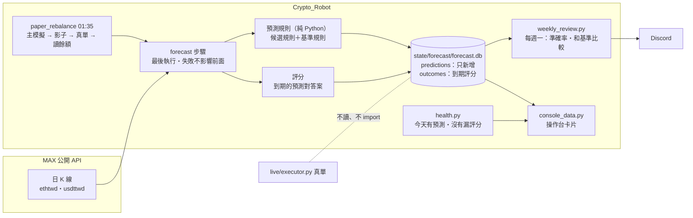
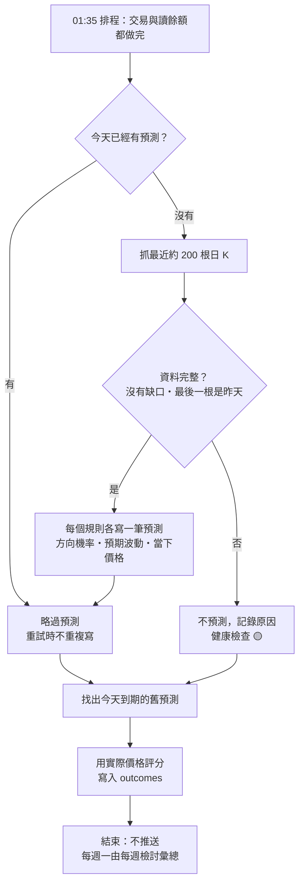
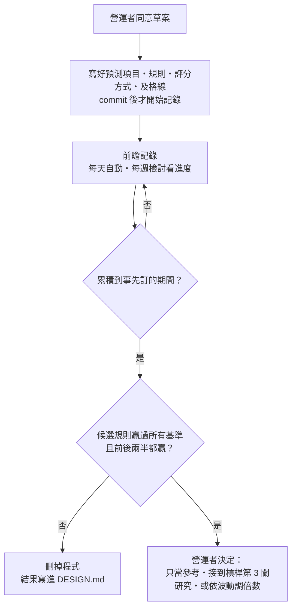

# Crypto_Robot 系統設計與規格（v1 草案）

> 個人自用、只操作自己帳戶的 MAX 現貨自動交易系統。
> 本文件整合三個來源：使用者提供的規格（Perplexity／Gemini 草擬）、Stock_Robot 的實戰教訓、2026-10-26 對 ccxt 與 MAX API 的實測。
> 原始規格和本文件不同的地方，集中列在[第 0 節](#0-與原始規格的差異2026-10-26-已確認)，每一項都附理由，2026-10-26 已全部確認採用。
> **v1 不寫任何策略程式碼以外的假設**：所有標「待確認」的項目，在寫對應程式前都要先查官方文件或實測。

## 目錄

0. [與原始規格的差異（2026-10-26 已確認）](#0-與原始規格的差異2026-10-26-已確認)
1. [MAX API 能力查核表](#1-max-api-能力查核表)
2. [技術選型與架構](#2-技術選型與架構)
3. [交易規則](#3-交易規則)
4. [RiskGuard 獨立風控](#4-riskguard-獨立風控)
5. [執行與 MAX 專屬安全要求](#5-執行與-max-專屬安全要求)
6. [研究、模擬帳戶與照抄標準（原規格沒有，從 Stock_Robot 補上）](#6-研究模擬帳戶與照抄標準)
7. [健康監控、備份、機密](#7-健康監控備份機密)
8. [開發順序](#8-開發順序)

---

## 0. 與原始規格的差異（2026-10-26 已確認）

| # | 原始規格 | 本文件 | 理由 |
|---|---|---|---|
| D1 | 使用 `ccxt.async_support` 連 MAX | **不使用 ccxt。MAX 一律用官方 REST v3＋WebSocket，以 aiohttp 自行實作** | 實測 ccxt 4.5.90 不支援 MAX。見第 1 節。 |
| D2 | 標的 BTC/USDT 或 BTC/TWD | **ETH/TWD**（設定檔參數，可改 `btctwd`） | 你先前選定 ETH 對台幣；BTC/TWD 在 MAX 也有，切換只改設定。 |
| D3 | 兩種停損：未實現虧損 ≥ 1%，以及「最後成交價 < 進場 K 線 low」 | 兩者並存，**哪個先到就觸發**：`stop_price = max(進場均價 × (1 − 1%), 進場 K 線 low)` | 原規格同時寫了兩個條件但沒說關係。取較高者＝較早出場、較保守。百分比與是否保留 K 線 low 條件，都是研究要驗證的參數（見 D6）。 |
| D4 | K 線成交量為 0 → 暫停計算 | **缺漏／時間戳不連續 → 暫停並補資料；成交量 0 → K 線有效，但該根不產生進場訊號**，記 🟡 | 實測 MAX ETH/TWD 最近 10,000 根 1h K 線（2025-09～2026-10）有 32 根成交量為 0、0 個缺口。若成交量 0 就整體暫停，系統每月會停兩次左右。成交量 0 時「大於前 20 根均量」本來就不成立，不會誤進場。 |
| D5 | DRY_RUN 只印 Log、模擬寫入與通知 | **DRY_RUN＝模擬帳戶**：用 MAX 即時盤口（order book）模擬市價成交、扣 taker 手續費，寫進獨立的 SQLite 檔 | Stock_Robot 的教訓：只有用真實盤口記帳的前瞻紀錄，才能判斷要不要照抄。模擬與真實資料庫分開，避免混用。 |
| D6 | 進出場參數直接定死（EMA 20/50、量 > 20 均、停損 1%） | 參數先列為**候選**，經研究期驗證、考卷期只考一次後才定案 | Stock_Robot 裡 28 個技術訊號中，黃金交叉這類追漲訊號 5 天內反而落後；且 MAX 一般等級 taker 0.16%，市價來回約 0.32%＋價差，1h 均線交叉若交易頻繁，成本可能吃掉全部優勢。見第 6 節。 |
| D7 | 每日虧損 ≥ 3% 熔斷，不自動恢復 | **保留**，但定位為「防程式錯誤」，不是策略規則 | Stock_Robot 回測中「帳戶虧損保險絲」讓績效變差，所以不當策略用。但在只有 1 個部位、停損約 1% 的設計下，單日虧 3% 幾乎只會在程式出錯、重複下單或極端跳空時發生，正適合當安全網。 |
| D8 | 部位大小未定義 | 新增 `position_pct`（可用台幣的比例）與**盤口深度上限**：市價單預估滑價 > 設定值（預設 0.3%）就縮小或不下 | 實測 ETH/TWD 前 5 檔每檔約 0.4～1.7 ETH；1h 成交額中位數約 217 萬台幣。部位太大時，市價停損的滑價會比停損本身還大。 |
| D9 | 「部位為 0」才算平倉完成 | 剩餘量 < `min_base_amount`（ETH 0.003）或 < `min_quote_amount`（250 TWD）視為**零頭（dust）**，算平倉完成並記錄 | 交易所不接受低於最小量的賣單，不定義的話會無限重試。 |
| D10 | 原規格沒有 | 新增：基準（一直持有 ETH）、研究期／考卷期、事先訂定的照抄標準與失效標準、影子帳戶、健康監控、備份、暫停開關 | 全部是 Stock_Robot 已驗證過的做法，見第 6、7 節。 |
| D11 | Python 3.11+ | Python **3.12** | 與 Stock_Robot 同版，方便共用環境與經驗。 |

> 現況（2026-10-28）：D1、D2、D10、D11 照用。D3、D4、D6～D9 是 EMA 規則的細節，隨第 3 節作廢。D5 的「DRY_RUN」改成模擬帳戶一直跑、真單另外用 `.env` 開啟（5.7）。

---

## 1. MAX API 能力查核表

**本專案不使用 ccxt**：2026-10-26 查最新版 ccxt 4.5.90，交易所清單沒有 MAX。MAX 連線層自己寫在 `exchange/max/`，日後換交易所只換這一層。

**查核方式（2026-10-26）**：直接呼叫 `https://max-api.maicoin.com/api/v3`。公開端點確認有回傳資料；私有端點不帶金鑰，確認回 401（路徑存在），而不是 404（路徑不存在）。

| 功能 | MAX 官方 API | 本系統使用 | 備註 |
|---|---|---|---|
| 市場資訊 | ✅ `GET /api/v3/markets`（實測） | ✅ | 取 `base_unit_precision`、`quote_unit_precision`、`min_base_amount`、`min_quote_amount`。ETH/TWD 實測：數量 6 位、價格 1 位、最小 0.003 ETH、最小 250 TWD。 |
| 報價 | ✅ `GET /api/v3/tickers?markets[]=ethtwd`（實測） | ✅ | 沒有用 WebSocket（一天只判斷一次）；成交價用盤口中間價。 |
| 1h K 線 | ✅ `GET /api/v3/k?market=ethtwd&period=60`（實測） | ✅ | 回傳 `[秒, o, h, l, c, v]`，最多 10,000 根；`timestamp` 參數可往回翻，最早至少到 2018。內部格式：時間轉 UTC 毫秒，數字一律轉 `Decimal`。 |
| 盤口 | ✅ `GET /api/v3/depth?market=ethtwd`（實測） | ✅ | 模擬成交與滑價上限都用它。 |
| 伺服器時間 | ✅ `GET /api/v3/timestamp`（實測） | ✅ | 判斷 K 線是否已收盤。 |
| 餘額 | ✅ `GET /api/v3/wallet/spot/accounts`（實測） | ✅ | 簽章已確認並實際使用（6.5）。 |
| 帳戶資訊 | ✅ `GET /api/v3/info`（實測） | ✅ | 含目前手續費等級：VIP 0，maker 0.08%、taker 0.16%。 |
| 下單 | ✅ `POST /api/v3/wallet/spot/order`（實測） | ✅（僅真單） | 用 `ioc_limit`；`client_oid` 最長 36 字元、24 小時內不可重複（6.5）。 |
| 取消訂單 | ✅ `DELETE /api/v3/order`（實測） | ✅ | 用 `client_oid` 取消；IOC 單查了幾次還是 `wait` 才會用到。全部取消的 `DELETE /api/v3/wallet/spot/orders` 沒有用。 |
| 查單 | ✅ `GET /api/v3/order?client_oid=`（實測） | ✅ | 可以用 `client_oid` 查。 |
| 未成交訂單 | ✅ `GET /api/v3/wallet/spot/orders/open` | 有方法、流程沒用 | 改用餘額的 `locked` 判斷有沒有掛單（5.4）。 |
| 成交紀錄 | ✅ `GET /api/v3/wallet/spot/trades`（401，路徑存在） | ❌ | 成交量與均價從查單結果取得。 |
| 手續費等級 | ✅ `GET /api/v2/vip_levels`（實測） | ❌ | 改用 `/api/v3/info`。 |

**當初列的待確認項目**（2026-10-26 查官方文件，結果在 6.5）：
- ✅ HMAC 簽章格式與 nonce 規則
- ✅ `client_oid` 長度與唯一期間；重複送出的錯誤碼沒有查（程式不重送，用不到）
- ✅ 下單參數（`volume` 是幣的數量）；沒有用市價單
- ❌ rate limit：沒有查，一天只送幾個請求
- ❌ WebSocket 私有頻道：沒有用

---

## 2. 技術選型與架構

> 現況（2026-10-28）：2.1 照用；2.2～2.3 的常駐 Agent 沒有實作（現在用排程腳本），做槓桿需要隨時盯維持率時再評估；2.4 是目前的目錄。

### 2.1 選型

| 項目 | 選擇 | 原因 |
|---|---|---|
| 語言 | Python 3.12 | 與 Stock_Robot 一致；`asyncio`、`decimal`、`zoneinfo` 都是標準函式庫。 |
| 非同步 | `asyncio` | 行情推播、停損監控、下單、通知需要同時進行，又不想開多執行緒處理鎖。 |
| HTTP／WebSocket | `aiohttp` | 一個套件同時處理 REST 與 WebSocket，直接接 MAX 官方 API（不用 ccxt，見 D1）。 |
| 交易所抽象 | 自寫 `exchange/max/` | 對外提供統一的資料格式（Decimal、UTC 毫秒），日後換交易所時其他 Agent 不用改。 |
| 數值 | `decimal.Decimal` | 禁止 float（見 5.1）。精度來自 `/markets`。 |
| 儲存 | SQLite（WAL 模式） | 單機、單一行程，不用架伺服器；交易、狀態、熔斷都要能撐過重啟。真實帳戶與模擬帳戶各用一個檔案。 |
| 測試 | `pytest`、`pytest-asyncio`、`unittest.mock` | 網路一律以假資料替代（Stock_Robot 的規則）；交易所層用錄下來的真實回應當測試資料。 |
| 時區 | `zoneinfo`＋`tzdata` 套件 | Windows 沒有內建 IANA 時區資料庫，`Asia/Taipei` 需要 `tzdata`。 |
| 設定 | `.env`（機密）＋`config.json`（參數） | 與 Stock_Robot 相同分法；`config.json` 讀入時檢查格式。 |

### 2.2 Agent 劃分

這裡的 Agent 是同一個行程裡的 asyncio task，不是 LLM。每個 Agent 只透過 Event Bus 溝通，不互相呼叫。

| Agent | 職責 | 只有它能做的事 |
|---|---|---|
| **Data** | 拉 1h K 線、接 WebSocket 成交、檢查資料品質（缺漏、時間戳、成交量）、補資料 | 寫入 K 線表；發出 `BarClosed`、`DataGap` |
| **Strategy** | 收到已收盤 K 線後計算指標、判斷進場訊號 | 發出 `EntrySignal`。**不看帳戶、不下單** |
| **RiskGuard** | 審查所有進出場意圖：部位數、熔斷、暫停開關、深度與滑價、部位大小；管理每日基準與熔斷 | 把意圖轉成 `OrderApproved`／`OrderRejected`；設定與解除熔斷 |
| **Execution** | 下單、查單、重試、部分成交追蹤、對帳；DRY_RUN 時用盤口模擬成交 | **唯一能呼叫下單／取消 API 的模組** |
| **Monitor** | 盯最後成交價做停損、計算即時權益、健康檢查、Discord 通知與防轟炸 | 發出 `StopTriggered`、`EquityUpdated` |

### 2.3 Event Bus

- 以 `asyncio.Queue` 實作的發布／訂閱：每個訂閱者一個 queue，事件是不可變的 dataclass（含 `event_id`、`ts`、`type`、`payload`）。
- **先寫入、後行動**：會改變部位的事件（`EntryIntent`、`ExitIntent`、`OrderApproved`、`OrderFilled`）先寫進 SQLite 的 `events` 表，再發布。重啟時從 SQLite 回放未完成的意圖，而不是從記憶體。
- 某個 Agent 拋出例外時，由 supervisor 記錄並重啟該 Agent；同一個 Agent 5 分鐘內重啟 3 次 → 進入 `HALTED` 並通知 🔴。
- 事件流：

```
Data ──BarClosed──▶ Strategy ──EntrySignal──▶ RiskGuard ──OrderApproved──▶ Execution
  │                                              ▲                            │
  └──Trade(last price)──▶ Monitor ──StopTriggered┘           OrderFilled ◀───┘
                             │                                     │
                             └──── Discord／健康檢查 ◀──── 所有事件 ─┘
```

### 2.4 目錄（2026-10-28 現況）

模擬帳戶、影子帳戶、真單都由排程腳本執行（01:35 與 08:30），不用常駐 Agent。上面 2.2～2.3 的常駐 Agent 架構沒有實作；
當時建的空資料夾（risk／execution／monitor）和沒通過的研究程式已刪除，需要時從 git 歷史找回（ff7425a 以前）。

```
Crypto_Robot/
├─ docs/                      DESIGN.md（本文件）、ARCHITECTURE.md（維運索引與流程圖）
├─ src/crypto_robot/
│  ├─ core/                   資料格式、Decimal 工具、台北時間工具
│  ├─ exchange/max/           MAX REST v3：public.py（行情）、private.py（簽章、餘額、下單、查單）
│  ├─ agents/
│  │  ├─ data/                K 線補資料、資料品質、日 K 合成
│  │  └─ strategy/            比例再平衡（純函式，研究、模擬、真單共用）：rebalance.py、rebalance_multi.py
│  ├─ store/                  K 線快取（SQLite）
│  ├─ notify/                 Discord（失敗不阻斷）
│  ├─ paper/                  模擬帳戶：盤口模擬成交、主帳戶與影子帳戶
│  ├─ live/                   真單：executor.py（安全檢查、下單、對帳）、readonly.py（真實餘額、IP）
│  ├─ lab/                    研究：基準、統計、比例再平衡回測與考卷
│  ├─ health.py               各 Agent 的健康檢查（操作台與主管讀）
│  ├─ weekly.py               每週事實檢討
│  └─ backup.py               備份 state/ 與 reports/
├─ scripts/                   paper_rebalance（01:35 與 08:30）、live_trade、live_check、weekly_review、console_data、
│                             backup、fetch_bars、research、排程（run_scheduled.cmd、register_tasks.ps1）
├─ tests/
├─ state/                     paper_main.db、shadow_rebal2.db、live/（真單 live.db、真實餘額、公開 IP）、research/、暫停檔（不進 git）
├─ data/                      K 線快取（不進 git）
├─ logs/                      排程紀錄（不進 git）
└─ reports/                   研究報告、每週事實檢討（不進 git）
```

## 3. 交易規則

> 本節是原始規格的 1h EMA 交叉規則。第一輪研究期 64 組全部未通過（6.3），程式已刪除，保留本節作為紀錄。
> 現況（2026-10-28）：作廢，只留紀錄；3.6 的停損執行方式（狀態機防重複觸發、跳空也觸發），做槓桿防強制平倉時可參考。

### 3.1 標的與部位限制

- 標的：MAX `ethtwd` 現貨（`config.json` 的 `market`）。
- 只做多。禁止做空、槓桿、合約、網格、Martingale、加倉。
- 同一時間最多 1 個部位；已有部位或有未完成的進場單時，忽略新訊號（記錄、不通知）。
- 部位大小：可用台幣 × `position_pct`，再受 D8 的盤口深度上限限制；低於 `min_quote_amount` 就不下單。

### 3.2 平倉定義

- 「平倉」＝賣出目前持有的全部 ETH 現貨部位。禁止部分賣出。
- 賣出失敗或部分成交：持續追蹤剩餘數量並重試，直到剩餘量成為零頭（D9），或進入 `MANUAL`（人工處理）。
- 重試：間隔 2、4、8、16、30 秒，之後每 30 秒一次；累計 10 分鐘仍未完成 → `MANUAL`＋🔴 通知。進入 `MANUAL` 後不再自動下單，等人工處理。
- 賣出數量以**交易所回報的實際可用餘額**為準，不以本地紀錄為準。

### 3.3 K 線與資料品質

- 週期 1h。K 線開始時間對齊 UTC 整點（MAX 回傳的時間戳即是）；每日風控另用台北時間，兩者分開。
- 「已收盤」：K 線開始時間 + 1h ≤ 交易所伺服器時間（`GET /api/v3/timestamp`），且再等 `bar_close_grace_sec`（預設 10 秒）讓最後的成交入帳。
- 進場訊號只用已收盤 K 線；未收盤的價格只用於停損。
- 資料品質（每次計算前檢查需要的最近 N 根）：
  - **缺漏或時間戳不連續** → 暫停產生訊號，先用 REST 補；補不到就維持暫停並記 🟡，連續 3 小時記 🔴。
  - **成交量 0** → K 線有效、照常算指標，但該根不產生進場訊號（見 D4）。
  - **價格異常**（high < low、收盤不在高低之間、和前一根差距超過 `max_bar_jump_pct`）→ 暫停並通知。

### 3.4 進場（候選規則，研究後定案）

- 當根已收盤 K 線 EMA20 上穿 EMA50（前一根 EMA20 ≤ EMA50，當根 EMA20 > EMA50），且當根成交量 > 前 20 根平均成交量（不含當根）。
- EMA 在 Decimal 上計算，暖機至少 `3 × 50` 根才開始產生訊號。
- 用市價買入；送單前 RiskGuard 檢查盤口深度。

### 3.5 出場（候選規則，研究後定案）

- 停損價 `stop_price = max(平均進場成本 × (1 − stop_loss_pct), 進場 K 線 low)`，`stop_loss_pct` 預設 1%（見 D3）。
- 平均進場成本以**實際成交**（含手續費）計算，不用下單時的報價。
- 最後成交價 ≤ `stop_price` → 立即送出市價平倉意圖。
- 原規格沒有停利或其他出場條件，所以 v1 只有停損會出場。研究時會測「均線死叉出場」作為對照（Stock_Robot 的經驗：停利常讓結果變差，所以不預設加入）。

### 3.6 停損執行：本地監控＋市價平倉

- Monitor 以 WebSocket 公開成交推播取得最後成交價；推播斷線超過 15 秒時，改用 REST `tickers` 每 2 秒輪詢，並記 🟡。
- **重複觸發**：部位有狀態機 `OPEN → EXITING → CLOSED`（另有 `MANUAL`）。只有 `OPEN` 才能觸發停損，觸發時用 SQLite transaction 原子地改成 `EXITING`，之後的價格更新一律忽略。
- **跳空**：觸發條件是 `≤ stop_price`，不是「剛好穿越」，所以價格直接跳到停損價下方也會觸發；用市價單，不設限價保護。
- **程式重啟**：啟動時先對帳（5.4），再根據最新價格重新評估停損；若重啟期間價格已跌破停損價，立即平倉。
- 停損不受熔斷與暫停開關影響：熔斷只擋新進場，**永遠允許平倉**。

---

## 4. RiskGuard 獨立風控

> 現況（2026-10-28）：沒有實作。現貨再平衡的保護是真單的下單前檢查（6.5）；槓桿「最多賠 10,000 元就停」（6.6）需要類似的每日基準與熔斷，到時候重新訂門檻。

### 4.1 每日基準（equity_baseline）

- 總權益 ＝ TWD 餘額（含凍結）＋ ETH 數量（含凍結）× 最後成交價。用 Decimal 計算。
- 每個台北時間交易日 00:00 記錄當下總權益為該日基準，寫入 SQLite `equity_baseline(date, equity, source)`。
- 盤中啟動且當日沒有基準時，以啟動時權益為基準，`source='startup'`。**當日已有基準就沿用，不能因為重啟而重設**（避免重啟把虧損歸零）。
- 00:00 剛好斷線、拿不到價格時：恢復連線後補記，`source='late'`，並記 🟡。

### 4.2 熔斷

- 每日累計虧損率 ＝ (equity_baseline − 當前總權益) ÷ equity_baseline。
- 虧損率 ≥ 3% → 執行熔斷：
  1. 寫入 SQLite `circuit_breaker(tripped_at, reason, equity, baseline)`；
  2. 取消所有未成交訂單；
  3. 停止產生新的進場訊號；
  4. 發送 Discord 🔴。
- 熔斷**不會自動解除**，跨日也不解除。解除只能用 `scripts/unhalt.py --reason "..."`，寫入操作紀錄（時間、原因、當時權益）。
- 熔斷期間仍允許停損平倉（3.6）。
- 定位見 D7：這是防程式錯誤的安全網，不是策略規則。

### 4.3 其他閘門（全部在 RiskGuard，Strategy 看不到）

| 閘門 | 擋住 |
|---|---|
| 暫停開關 | 存在 `state/paused` 檔案時，不進新部位（與 Stock_Robot 相同） |
| 部位數 | 已有部位或有未完成的進場單 |
| 熔斷 | 已觸發 |
| 資料品質 | Data Agent 回報暫停中 |
| 盤口深度 | 以當下 depth 估算的市價滑價 > `max_slippage_pct` |
| 最小下單量 | 低於 `min_base_amount` 或 `min_quote_amount` |
| 對帳不一致 | 本地紀錄和交易所餘額或訂單不一致，且還沒處理 |

---

## 5. 執行與 MAX 專屬安全要求

> 現況（2026-10-28）：已在真單實作（`live/executor.py`、`scripts/live_trade.py`）；5.1～5.7 已逐條和程式核對，改成實際做法。

### 5.1 禁止 float

- 所有價格、數量、金額都用 `Decimal`。從 API 收到的值一律用字串建立 `Decimal`（`Decimal("76827.3")`，不用 `Decimal(76827.3)`）；`core/num.py` 的 `to_decimal` 遇到 float 直接報錯，`loads` 解析 JSON 時數字一律變成 Decimal。
- 送單前依 `/markets` 精度處理：數量用 `amount_to_precision` **無條件捨去**（避免超賣）；限價用 `live/executor.py` 的 `limit_price`：買價無條件捨去（不超過上限）、賣價無條件進位（不低於下限）。
- 測試（`tests/test_max_public.py`）：`to_decimal` 拒絕 float、`loads` 不會產生 float。

### 5.2 冪等性與 client_oid

- 格式 `cr2-{台北時間 YYYYMMDDHHMMSS}-{uuid4 前 8 碼}`，共 27 字元（≤ 36）（`new_client_oid`）。
- 產生後**先寫入 SQLite 再送單**。
- 交易所明確拒絕（4xx，不含 429）→ 標記 rejected，不重送。
- 送單逾時、連線中斷、5xx／429，結果未知 → 用 `client_oid` 查單，以查到的為準；**查不到就標記 unknown 並停止，不重送**，08:30 推 🔴，等營運者到 MAX 確認。
- 同一天已有訂單紀錄（例如送到一半當機）→ 重試時只對帳、不送新單。

### 5.3 訂單狀態機

訂單（`state/live/live.db` 的 `orders` 表）：送出前寫入 `pending` → 之後照 MAX 回報的 `state`（`wait`、`done`、`cancel`）更新，
另有本地的 `rejected`（交易所明確拒絕）與 `unknown`（送出後查不到）。`done`、`cancel`、`rejected`、`unknown` 是最終狀態。
IOC 單照理立即結束；查了幾次還是 `wait` 就取消再查。每次更新記成交量、均價、交易所訂單編號與錯誤訊息（不存完整原始回應）。
沒有 `MANUAL` 狀態：`unknown` 就是停下來等營運者到 MAX 確認。
每天的執行紀錄（`runs` 表）另有狀態：`done`（下單完成）、`hold`（不用調）、`blocked`（安全檢查擋下）、`reconciled`（只對帳）；`running` 代表沒跑完。

### 5.4 下單前對帳

沒有獨立的啟動對帳，做法是**每次都用交易所的實際餘額計算**，不靠本地持倉紀錄，所以不會有「本地以為沒持倉、交易所有 ETH」的情況：

1. 同一天已有訂單紀錄 → 只把還沒到最終狀態的訂單查到底（查不到標 `unknown`），不送新單。
2. 讀交易所餘額：有掛單凍結（`locked` > 0）、總權益超過階段上限，或其他安全檢查不過（6.5）→ 整天不下單（`blocked`）。
3. 依實際餘額算比例與下單量。
4. 營運者自己在 MAX 手動買賣或入金：機器人隔天照新的餘額再平衡；權益超過階段上限就會被擋下。所以帳戶要專用，手動操作前先放暫停檔。

### 5.5 金鑰安全

- API Key 只開查詢＋交易，**不開提領**，設定 IP 白名單。MAX API 讀不到金鑰權限，「沒開提領」由營運者在 MAX 網頁確認（2026-10-26 已確認）；程式裡也沒有提領方法（`exchange/max/private.py`）。
- `MAX_API_KEY`、`MAX_API_SECRET`、`DISCORD_WEBHOOK_URL`／`PAPER_WEBHOOK_URL` 只從 `.env` 讀；`.env` 不進 git。
- 金鑰不寫進紀錄或錯誤訊息（客戶端的 `__repr__` 隱藏金鑰）；Discord 推送失敗時只記錯誤類型，不印網址。
- 健康檢查（`health.py`）：`.env` 沒被 git 追蹤、專案資料夾最上層沒有像金鑰的文字檔、紀錄檔裡沒有 webhook 網址；操作台顯示紀錄時也會遮掉 webhook。不掃描金鑰字串。
- 真單沒開時仍會載入金鑰，但只用來**查詢**：01:35 讀真實餘額與公開 IP、操作台「重新讀取真實餘額」（`MaxPrivateClient`，沒有下單方法）。會下單的 `MaxTradingClient` 只有在真單開啟時才建立。

### 5.6 Discord

- 01:35 的執行不推送；**每天 08:30 推一則報告**（主帳戶、影子、真單結果、真實帳戶；沒跑成、被擋下、送單沒跑完等問題標 🔴；完整的健康燈號看操作台）；每週一另推每週事實檢討。
- 沒有「🔴 立即推送」與防轟炸：01:35～07:35 發生的問題在 08:30 一起推。跟真錢有關的 🔴 由主管（`../Cashflow_orchestrator`，每 3 小時）自動暫停並立即推送。
- 發送失敗不阻斷交易，只寫本地日誌。
- 優先用 `PAPER_WEBHOOK_URL`，沒有才用 `DISCORD_WEBHOOK_URL`。

### 5.7 DRY_RUN（模擬帳戶）

- 沒有 `DRY_RUN` 開關：模擬帳戶一直在跑；真單要 `.env` 同時有 `LIVE_TRADING=1` 和 `LIVE_CONFIRM=I_UNDERSTAND` 才會下單（`scripts/live_trade.py`），避免改錯一個值就開始下真單。
- 模擬成交：市價單用當下 `depth` 逐檔吃單計算成交均價，扣 taker 手續費；深度不足以成交的部分視為未成交（會走重試流程）。
- 模擬帳戶有自己的 SQLite 檔（主帳戶 `state/paper_main.db`、影子 `state/shadow_rebal2.db`），和真單的 `state/live/live.db` 完全分開。

---

## 6. 研究、模擬帳戶與照抄標準

原規格沒有這一節。這裡是 Stock_Robot 最重要的教訓：**先證明規則有用，再讓它碰錢**。

### 6.1 基準

- 主要基準：同一筆台幣在第一天全部買 ETH、一直持有（扣一次買入成本）。
- 次要基準：全部持有台幣（報酬 0）。
- 報告同時列報酬、最大回撤、交易次數、總手續費與滑價。若策略報酬輸給一直持有、但回撤明顯較小，要明白寫出來，由你判斷值不值得。

### 6.2 資料與成本

- 資料來源：MAX `ethtwd` 1h K 線，往回抓到最早（實測至少到 2018）。
- 早期流動性很差，研究起點要依流動性決定，不能直接從第一根算起。2026-10-26 實測（`scripts/fetch_bars.py`，尚未跑任何策略）：
  - 共 76,040 根，2018-02-21 ～ 2026-10-25（UTC），沒有缺漏、時間戳錯誤或價格異常。
  - 每年的成交量 0 比例與每小時成交額中位數（台幣）：

    | 年 | 成交量 0 | 每小時成交額中位數 |
    |---|---|---|
    | 2018 | 19.9% | 57,444 |
    | 2019 | 13.2% | 74,466 |
    | 2020 | 4.0% | 207,769 |
    | 2021 | 0.0% | 2,551,763 |
    | 2022 | 0.3% | 2,003,086 |
    | 2023 | 0.4% | 1,131,591 |
    | 2024 | 0.2% | 2,193,017 |
    | 2025 | 0.1% | 3,383,594 |
    | 2026（至 10/25） | 0.4% | 1,650,395 |

  - **研究起點建議 2021-01-01**：2020 年以前成交額不到現在的十分之一，成交量 0 的比例也高，價格不代表現在能成交的價格。
- 若 MAX 有效歷史太短，可加入 Binance ETH/USDT × 美元兌台幣做研究用的對照，但**照抄標準只看 MAX 的資料**。
- 成本：taker 0.16%（等級 0）＋用歷史 K 線估計的滑價（無歷史盤口，保守假設每次 0.1%，研究時做敏感度分析）。

### 6.3 研究期與考卷期

- **切點（2026-10-26 定案）**：研究期 2021-01-01～2023-12-31（3 年）、考卷期 2024-01-01 起。依據只有上面的資料品質，當時**尚未看任何策略結果**。寫在 `src/crypto_robot/lab/periods.py`，之後不改。
- 研究期可以比較多組參數；同時比較很多組時，要 |t| ≥ 3 而且前後半期方向一致才算有效。
- 考卷期只考研究期選出的那一組，**只考一次**，結果存檔，之後執行只顯示當時的結果（同 Stock_Robot `chips_holdout.json` 的做法）。
- 原規格的 EMA20/50＋量能＋1% 停損，就是研究期第一組要測的規則。
- 研究期比較 64 組（2 組均線 × 4 種停損 × 停損是否用訊號 K 線低點 × 量能過濾 × 死叉出場），全部資金進出。四項全過才算通過（2026-10-26 看結果前訂定）：
  1. 完成交易 ≥ 30 筆；
  2. 每筆淨報酬平均值 t ≥ 3；
  3. 前後半期（以 2022-07-01 切開）報酬都 > 0；
  4. 前後半期都不輸一直持有 ETH：報酬較高，或「報酬 ÷ |最大回撤|」較高。
- 沒有任何一組通過時，不放寬標準，該規則族不進考卷期。
- **研究期結果（2026-10-26，`reports/research_dev_ema1h_20261026.md`）：64 組全部未通過，EMA 交叉規則族不進考卷期，考卷期仍未使用。**
  - 基準：一直持有 ETH 報酬 +241%、最大回撤 -80%。
  - 原始規格的規則（`ema20_50-vol-sl1-low`）2021-01-02 第一次進場後，價格三年都沒跌回停損價，0 筆平倉、等於從那天起一直持有。
    唯一的出場是停損，所以結果只取決於第一筆的進場時點。有 19 組是這種情況。
  - 有死叉出場的組合：t 值最高 1.55（標準 3）；均線 20/50 的組合後半期全部虧損。
    均線 50/200＋死叉出場的回撤明顯較小（約 -28%～-48%），但後半期都輸給一直持有。這是看過研究期之後的觀察，不能直接當成已驗證。
  - 結論與 Stock_Robot 一致：追漲型技術訊號扣掉成本後，沒有贏過直接持有。
- **第二輪（日 K，2026-10-26 看結果前訂定，`lab/daily_variants.py`）**：目標改成降低回撤，或靠買低賣高賺價差；收盤判斷、隔天開盤成交，交易少、成本低。
  - 22 組：趨勢（站上 50／100／200 日均線才持有，確認 1 或 3 天）6 組；均線乖離買低賣高（跌到 20 日均線下 10／15／20% 買、回到均線賣，可選 30 天時間停損、15% 停損）12 組；RSI 買低賣高（RSI14 < 25／30 買、> 55／70 賣）4 組。
  - 五項全過才算通過：交易 ≥ 8 筆；研究期最大回撤 ≤ 持有的 60%；前後半期報酬都 > 0；前後半期都不輸持有（報酬或報酬÷回撤）；前後半期回撤都比持有淺。
  - 日線規則交易次數少，t 值沒有意義，改用回撤與前後半期一致性；真正的檢驗是考卷期。
  - 已知污染：研究期資料第一輪已看過，趨勢類的靈感來自第一輪的觀察。
  - 若沒有任何一組通過：依你的決定，不做定期定額，再討論其他買低賣高的做法。
  - **研究期結果（2026-10-26，`reports/research_dev_daily_20261026.md`）：22 組全部未通過，不進考卷期，考卷期仍未使用。**
    - 趨勢類：sma50 報酬 +301%、回撤 -51%（持有 -78%），但後半期都輸給持有，回撤也沒有淺到標準。
    - 均線乖離買低賣高：勝率 60～83%，但 2022 上半年的崩跌中「跌深買進」一路接刀，前半期幾乎全部虧損；整體 12 組有 9 組虧錢。
    - RSI 買低賣高：3 年只有 3～5 筆交易，前半期全部虧損。
    - 結論：單一幣種的擇時規則（追漲或買低），在這段期間都贏不過一直持有。
- **第三輪（比例再平衡，2026-10-26 看結果前訂定，`lab/rebalance_variants.py`）**：固定 ETH 占總權益的目標比例，偏離達門檻時調回（漲多賣、跌深買）。
  - 12 組：目標比例 30／50／70% × 偏離門檻 5／10／15／20 個百分點；每天收盤判斷、隔天開盤成交。
  - 基準是同比例買進後不再調整，衡量的是再平衡本身有沒有多賺。
  - 五項全過才算通過：再平衡 ≥ 8 次；研究期報酬高於不再平衡；前後半期都高於不再平衡；最大回撤不比不再平衡深；前後半期報酬都 > 0。
  - 已知污染：研究期資料前兩輪已看過。
  - **研究期結果（2026-10-26，`reports/research_dev_rebalance_20261026.md`）：12 組全部未通過，不進考卷期，考卷期仍未使用。**
    - 12 組在整個研究期**全部**比不再平衡多賺（+6%～+82%），最大回撤也全部較淺（例如 50% 組 -47%～-52%，不再平衡 -68%）。
    - 但 12 組在後半期（2022-07～2023，ETH 一路上漲 +126%）**全部**比不再平衡少賺（-11%～-24%）：上漲途中一直賣出，持有的 ETH 比不再平衡少。這是再平衡在單邊趨勢中的已知代價。
    - 另有 7 組再平衡次數不到 8 次。
    - 依事先訂的標準判定未通過，不放寬。和前兩輪不同的是，方向在 12 組之間一致，而不是零星幾組好看。
- **第四輪（凌晨時段買低賣高，2026-10-26 看結果前訂定，`lab/intraday_variants.py`）**：使用者白天要用電腦，只允許台北時間 01:30～07:30 自動交易，不留倉過夜。
  - 每天 01:30 開始，07:20 撤單並市價平倉，07:30 前清空；每晚最多 3 次來回；虧損 5% 市價停損、當晚不再進場（停損 5% 由使用者決定）。
  - 進場與停利用限價單（一次只掛一張，不是網格），停損與平倉用市價單；5 分 K（MAX 有 2021 年起的資料）。
  - 16 組：相對 01:30 價格跌 0.5／1.0／1.5% 買、漲 0.5／1.0% 賣（6 組）；低於 2 小時均線 2／2.5 倍標準差買、回到均線賣（2 組）；各加「前一天收盤在 20 日均線上才做」開關。
  - 成交假設：限價單要穿過掛價才成交，每根最多成交該根成交量的 10%；市價單加 0.1% 滑價。
  - 看結果前的流動性實測：研究期凌晨每根 5 分 K 成交額中位數約 2.5 萬台幣，24% 沒有成交，2023 年更少。10% 上限下中位數只能成交約 2,500 元。
  - 七項全過才算通過：交易 ≥ 100 筆；t ≥ 3；前後半期報酬都 > 0；前後半期都贏時段內單純持有（不計成本）；最大回撤 ≤ 10%；限價單改以市價計仍賺錢；平均每筆成交 ≥ 1 萬台幣（使用者加入）。
  - **研究期結果（2026-10-26，`reports/research_dev_intraday_20261026.md`）：16 組全部未通過，而且全部虧損，不進考卷期，考卷期仍未使用。**
    - 16 組報酬 -29%～-92%，每筆平均 -0.20%～-0.34%，t 值 -1.9～-11.2：不是「沒賺到」，而是統計上顯著地虧。
    - 勝率 44～68%，但停利只賺 0.5～1%，07:20 強制平倉與停損的虧損較大，再加上每筆成本，整體虧損。
    - 「不接刀」開關讓虧損減半（只因為交易的夜晚少一半），沒有一組因此轉正。
    - 平均每筆成交 2～6 萬台幣，10% 成交量上限不是主要問題。
    - 觀察（看過研究期之後，不能當成已驗證）：凌晨時段不計成本的單純持有，研究期累積 +84%，價格在這段時間偏向上漲。逆勢買低賣高等於在上漲時段做反向操作。
- **四輪合計（2026-10-26）**：4 個規則族、共 118 組，研究期全部未通過。研究期資料已經看過四次，再用同一段資料找規則，找到的很可能只是巧合；考卷期是唯一還沒被看過的資料，只能用一次。
- **第五輪（ETH＋USDT＋台幣 三資產再平衡，2026-10-26 看結果前訂定，`lab/multi_variants.py`）**：使用者的想法：股市走向影響匯率也影響虛擬貨幣，把現金的一部分換成 USDT（≈ 美元），閒錢也在動，並可能在 ETH 大跌、台幣貶值時抵掉一部分損失。
  - 4 組：ETH 固定 50%，剩下現金中 USDT 占 50%／75% × 門檻 5／10 個百分點；任何一項偏離就全部調回。USDT/TWD 資料 2020-12 起無缺漏，每小時成交額中位數 560 萬～1,300 萬台幣。
  - 比較對象是現在的兩資產再平衡（ETH 50%＋台幣，同門檻）。五項全過才算通過：再平衡 ≥ 8 天；研究期報酬高於兩資產；前後半期都高於兩資產；最大回撤不比兩資產深；前後半期報酬都 > 0。
  - 考卷期已用掉，這輪沒有考卷。不論結果，`rebal3-eth50-cashusdt75-band10`（使用者指定的配置）都放進影子帳戶並行觀察。
  - **研究期結果（2026-10-26，`reports/research_dev_rebalance3_20261026.md`）：4 組中 1 組通過（`rebal3-eth50-cashusdt75-band5`），但優勢很小。**
    - 通過的那組：+145.5% 對兩資產 +138.9%（三年多 6.6 個百分點），回撤 -49.0% 對 -50.4%，後半期只多 0.6 個百分點。
    - 使用者指定的 `cashusdt75-band10`：+149.7% 對兩資產 +160.1%，四項不過。門檻 10 時三資產多了「台幣比例」也會觸發，再平衡時點和兩資產不同，差距主要來自時點而不是 USDT。
    - 同門檻下把 USDT 從現金的 50% 提高到 75%，報酬都多約 3.5 個百分點：研究期美元兌台幣從約 27.9 升到 31.1，這是匯率走勢，不代表 USDT 能穩定避險。
    - 同時比較 4 組只過 1 組、差距小，證據偏弱；沒有考卷可驗證。依使用者決定，`cashusdt75-band10` 照原計畫放進影子帳戶。
- **第六輪（三資產再平衡改成每小時檢查，2026-10-28 看結果前訂定，`lab/hourly_variants.py`）**：使用者的問題：不限一天一次，只要偏離達門檻隨時調回，收益會不會比較好？前五輪全部用日 K 回測，只驗證過一天檢查一次。
  - 4 組：ETH 50%＋USDT 37.5%＋台幣 12.5%，門檻 5／10 個百分點 × 「24 小時」或「只在台北 01:30～08:00 下單」（`-win`，觸發保留到時段內再重算）。每小時收盤判斷、下一小時開盤成交，成本同前幾輪。
  - 比較對象是同一條規則、一天檢查一次（現在的做法）。五項全過才算通過：再平衡 ≥ 8 次；研究期報酬高於每日版；前後半期都高於每日版；最大回撤不比每日版深；滑價加倍（兩邊都加倍）後報酬仍高於每日版。
  - 研究期已看過五次、沒有考卷；通過只代表值得再觀察，不直接改真單。執行：`scripts/research.py --family rebalance3-1h --stage dev`。
  - **研究期結果（2026-10-28，`reports/research_dev_rebalance3-1h_20261028.md`）：4 組全部未通過，維持一天檢查一次。**
    - 最接近的是 `band5-1h-24h`：+159.7% 對每日版 +145.5%（三年多 14.2 個百分點），前後半期都多賺，滑價加倍仍多 13.3 個百分點；但回撤 -51.5% 對 -49.0%，第 4 項不過。不放寬標準。
    - `band10-1h-24h`：多 6.1 個百分點，但後半期少賺、回撤較深。
    - 只在 01:30～08:00 下單的兩組都沒有比每日版好（-0.2、-5.8 個百分點）：限定時段時，每小時檢查沒有幫助。
    - 24 小時版多賺的部分可能只是巧合（研究期看過五次、同時比 4 組、沒有考卷）；要 24 小時下單還得電腦全天開著、白天也會下單、安全機制重新設計。
  - **2024-01-01～2026-10-23 參考回測（2026-10-28 使用者要求；這段在第三輪已當過考卷，不是乾淨的驗證，不改變上面的結論）**：4 組仍全部未通過。
    - 研究期最接近的 `band5-1h-24h` 反而比每日版少 1.9 個百分點（+20.5% 對 +22.5%），回撤 -40.4% 對 -37.7%；6,000 元期末 7,232 對 7,348。
    - `band10` 兩組多 5.6 個百分點，但後半期少賺、回撤較深。
    - 兩段資料裡沒有一組穩定贏過每日版，而且每小時版的回撤都比較深。
- **第七輪（山寨幣橫盤後帶量突破，2026-10-30 看結果前訂定，`lab/breakout_variants.py`）**：使用者想找「接下來可能大漲的幣」，參考漏斗篩選法；第 1～3 步（基本面、鏈上、社群）拿不到當時的歷史資料，這輪只測第 4 步（技術面）。
  - 資料：MAX 44 個非穩定幣台幣市場的日 K（`fetch_bars.py --period 1440`）；訂定前只看過上市日與每年成交額。2026-10-30 只有 BTC、ETH、ADA、SOL、DOGE、XRP 的 24 小時成交額超過 400 萬元，其他小幣價差 50～2,100 bp。
  - 山寨幣資料第一次用：研究期 2021-07-01～2024-06-30（前後半以 2023-01-01 切開），考卷期 2024-07-01 起，只考一次（`state/research/holdout_breakout.json`）。
  - 信號：前 30 天每日成交額中位數 ≥ 50 萬元；前 N 天最高 ÷ 最低 ≤ 1.4；收盤突破前 N 天最高；當天成交額 ≥ 中位數 × 3。隔天開盤買、持有 H 天後開盤賣。4 組：N 60／120 × H 14／30。成本 taker 0.16%＋滑價每邊 0.5%。
  - 研究期六項全過才算：信號 ≥ 30 次且 ≥ 5 個幣；扣成本後比同期持有 ETH 的平均超額報酬 t ≥ 3；前後半期都 > 0；贏過 95% 的隨機進場（同幣、同次數，1,000 次）；滑價每邊 1% 仍 > 0；拿掉超額合計最多的幣仍 > 0。
  - 考卷期只考通過組中 t 最高的一組：信號 ≥ 15 次、平均超額 > 0、贏過 90% 的隨機進場。
  - 已知限制：只有現在還在 MAX 上的幣（倖存者偏差，結果偏樂觀）；歷史價差查不到。執行：`scripts/research.py --family breakout --stage dev`。
  - **研究期結果（2026-10-30，`reports/research_dev_breakout_20261030.md`）：4 組全部未通過，不進考卷期。**
    - 信號太少：三年只有 4～21 次（標準 30 次）。山寨幣三年裡很少「橫盤區間不到 40%、又有足夠成交量」。
    - N60 兩組平均比 ETH 多 2.4%／5.8%，也贏過 97%／100% 的隨機進場，但 t 只有 0.7～0.8；拿掉 DOGE（5 次平均多 14.2%、4 次多 34.7%）後就輸 ETH。優勢幾乎都來自單一個幣。
    - 結論：在 MAX 能交易的幣裡，這個技術面規則找不到可靠的優勢。考卷期保留沒用。
- **第八輪（恐懼與貪婪指數＋RSI，BTC／ETH，2026-10-30 看結果前訂定，`lab/fear_variants.py`）**：來自使用者提供的 Bybit 文章的「多方法交叉確認」（RSI < 30＋恐懼與貪婪指數 < 25）。
  - 指數：alternative.me 每天一筆（2018-02 起，缺 4 天），每次執行重新下載存到 `data/fng.json`；訂定前只確認過資料完整度。
  - 期間同第七輪：研究期 2021-07-01～2024-06-30（前後半以 2023-01-01 切開），考卷期 2024-07-01 起只考一次（`state/research/holdout_fear.json`）。BTC 沒研究過；ETH 研究期價格已看過六次。
  - 4 組：恐懼與貪婪指數 < 25 且 RSI(14) < 30／只看恐懼 × 持有 30／90 天。當天指數（UTC 00:00 公布）＋收盤判斷，隔天開盤買、H 天後開盤賣，持有期間不接新信號。成本 0.16%＋0.1%。
  - 研究期：BTC、ETH 各自五項全過才算——信號 ≥ 8 次；贏過 95% 的隨機進場；超額報酬（減去同期間任意一天進場的平均）t ≥ 3；前後半期都 > 0；滑價加倍仍 > 0。
  - 考卷期只考通過組中 t（兩幣較小者）最高的一組：兩個幣都要信號 ≥ 4 次、平均超額 > 0、贏過 90% 的隨機進場。
  - 已知限制：信號很少；BTC 與 ETH 常同一天出信號；信號接近現在的再平衡（跌多就買），這輪不和再平衡比較。執行：`scripts/research.py --family fear --stage dev`。
  - **研究期結果（2026-10-30，`reports/research_dev_fear_20261030.md`）：4 組全部未通過，不進考卷期。**
    - 所有信號都落在 2021-07～2022-11（2023 年起研究期內沒有一天指數 < 25），後半期 0 次；等於只測了一段熊市。
    - 在那段熊市裡「恐慌時買」大多**比任意一天買還差**：交叉確認組 ETH 持有 30 天平均 -18.0%（任意進場 +3.6%），只看恐懼持有 90 天 BTC -16.4%（任意 +10.0%）。恐慌常常不是底部，之後還會更低。
    - 唯一接近持平的是只看恐懼、持有 30 天（13 次，BTC -0.7%、ETH +0.7%，t ≈ 0），和隨便買沒有差別。
- **第九輪（BTC＋ETH＋USDT＋台幣 四資產再平衡，2026-10-30 看結果前訂定，`lab/basket_variants.py`）**：第六～八輪找時機、找飆漲幣都沒通過；八輪只留下比例再平衡，這輪把它的籃子加上 BTC。
  - 4 組：USDT 37.5%＋台幣 12.5% 不變，BTC／ETH 25／25 或 15／35 × 門檻 5／10。日 K（台北 00:00），引擎同第五輪；成本 0.16%＋0.1%。BTC 1h 資料 2020-12 起，沒有 blocking 問題。
  - 比較對象：現在真單的規則 `rebal3-eth50-cashusdt75-band5`。研究期 2021-01-01～2024-06-30（前後半以 2022-10-01 切開）。
  - 研究期五項全過才算：再平衡 ≥ 8 天；研究期報酬高於現行規則；前後半期都高於；最大回撤不比現行規則深；滑價加倍仍高於。
  - 考卷期 2024-07-01 起只考研究期通過組中領先最多的一組（`state/research/holdout_basket.json`）：報酬高於現行規則、回撤不比它深。BTC 這段沒看過、ETH 看過（半乾淨）。
  - 已知限制：研究期 ETH 已看過六次；BTC 和 ETH 高度相關。執行：`scripts/research.py --family basket --stage dev`。
  - **研究期結果（2026-10-30，`reports/research_dev_basket_20261030.md`）：4 組全部未通過，不進考卷期，維持現行規則。**
    - 現行規則研究期 +220.8%；四組 +163%～+192%，少 28～58 個百分點，差距全在前半期（2021 年 ETH 漲幅遠大於 BTC）。
    - 加入 BTC 的好處只有：回撤略淺（-43.6%～-47.6% 對 -49.0%）、後半期多 3～16 個百分點。BTC 越多，報酬越少、回撤越淺，就是換了一個比較保守的配置，不是額外的收益。
- **九輪合計（2026-10-30）**：只有比例再平衡（第三、五輪）留下，就是現在真單的規則。抓時機、更常檢查、找飆漲山寨幣、看恐懼指數、擴大籃子都沒通過。營運者沒有放棄找新規則（2026-10-30：仍想研究「漲幅前幾名」的幣），之後照同樣流程先訂標準再跑。
- **第十輪（山寨幣追漲幅前幾名，2026-10-30 看結果前訂定，`lab/momentum_variants.py`）**：營運者看到漲幅前 5 名還是心癢——漲完才買，還來得及嗎？
  - 每週一（UTC）收盤，在 MAX 非穩定幣、非 ETH 的台幣市場中，前 30 天每日成交額中位數 ≥ 50 萬元的幣裡，挑過去 L 天漲最多的前 K 名，隔天開盤等金額買、持有一週；留在名單的不動，只換掉掉出的。可選的幣少於 2K 個就持有現金。4 組：L 7／30 × K 3／5。成本只算換手：0.16%＋滑價每邊 0.5%。
  - 訂定前只看過每週可選幣的數量（研究期中位數 11 個、最少 3 個），沒有看過排名或報酬。期間同第七輪：研究期 2021-07-01～2024-06-30（前後半以 2023-01-01 切開），考卷期 2024-07-01 起只考一次（`state/research/holdout_momentum.json`）。
  - 研究期六項全過才算：有交易 ≥ 80 週；每週超額報酬（減去同週全部可選幣等權重，不扣成本）t ≥ 3；前後半期都 > 0；贏過 95% 的隨機挑 K 個（同樣成本規則）；滑價加倍仍贏全部等權重；最大回撤不比一直持有 ETH 深。
  - 考卷期只考通過組中 t 最高的一組：總報酬贏全部等權重與持有 ETH、贏過 90% 的隨機挑選、回撤不比 ETH 深。
  - 已知限制：倖存者偏差；研究期山寨幣資料第七輪用過（只看了突破日）；每週換手的成本可能是主要障礙。執行：`scripts/research.py --family momentum --stage dev`。
  - **研究期結果（2026-10-30，`reports/research_dev_momentum_20261030.md`）：4 組全部未通過，不進考卷期。**
    - 四組三年總報酬 **-85%～-92%**（最大回撤 -90%～-95%）；同期持有 ETH +77.5%，山寨幣全部等權重 -62%～-74%（不扣成本）。
    - 每週平均比全部等權重再少 0.5～1.0%（t -1.3～-2.8），前後半期都輸；大部分差距來自每週換手的成本，選股本身也沒有比隨機挑好（贏過 44%～90%）。
    - 結論：「漲完才追」在 MAX 山寨幣上是虧損最嚴重的做法；山寨幣整體在研究期也遠輸 ETH。
  - 第十輪的程式 2026-10-30 已刪除，要找回就看 `git show c67c3b1 --stat`。
- **第十一輪（槓桿第 3 關：ETH 槓桿再平衡，2026-11-01 看結果前訂定，`lab/leverage_variants.py`）**：營運者決定提前做第 3 關的回測（只回測；第 4、5 關仍要等第 1、2 關，見 6.6）。
  - MAX 借滿益（2026-11-01 查）：可借 BTC、ETH、USDT、LINK、DOGE、LTC，**台幣不能借**；USDT 目前可借額度 **0**（回測假設借得到，第 5 關前要問 MAX）；
    利率只查得到現在的（USDT 每小時 0.0000182，年化約 16%）；維持率（資產 ÷ 負債）1.5 借款上限、1.3 追繳、1.2 強平，來自第三方文章與 2022 年官方部落格，沒有官方最新數字。
  - 模擬（`lab/leverage_backtest.py`，逐小時）：ETH 部位＝權益 × L，不足借 USDT；USDT 負債按小時複利；用每小時 ETH 最低價、USDT/TWD 最高價算維持率，≤ 1.2 強平（殘值先扣資產 5%，帳戶結束）；
    每天台北 00:00 收盤檢查，實際槓桿偏離 ±B 就下一根開盤調回。4 組：L 1.5／2 × B 0.2／0.5。成本 0.16%＋0.1%。
  - 期間：2021-01-01 到資料最後一天（沒有考卷期），前後半以 2024-01-01 切開。比較對象：1 倍（同一個模擬＝一直持有 ETH）；現在真單的現貨規則只列參考。
  - 五項全過才算：整段沒強平；維持率最低 > 1.3；前後半期報酬都 > 1 倍；最大回撤不超過 -60%；利率加倍後前後半期仍 > 1 倍。沒通過就不做槓桿。
  - 執行：`scripts/research.py --family leverage --stage dev`。
  - **結果（2026-11-01，`reports/research_leverage_20261101.md`）：4 組全部未通過 → 依 6.6 不做槓桿，留在現貨。**
    - 參考：1 倍（一直持有 ETH）前半 +241.3%、後半 +3.9%、最大回撤 -80.1%；現在真單的現貨規則前半 +146.2%、後半 +22.5%、回撤 -49.0%。
    - 2 倍兩組都在 **2021-05-19**（ETH 一天內大跌）被強平；1.5 倍沒強平，但最大回撤 -86%～-95%，後半期（2024 起）都輸 1 倍。
    - 最好的 `lev1.5-band0.5` 期末 38,467 元（10,000 起），是因為前半段 2021 大漲；同期間付了約 8,500 元利息（USDT 年化約 16%）。利率加倍後後半期 -44.5%。
    - 結論：放大後只是把 ETH 的大漲大跌放得更大，再加上利息；這段資料裡沒有一組能同時活過大跌又贏過不開槓桿。
  - 第十一輪的程式 2026-11-01 已刪除，要找回就看 `git show b846628 --stat`。
- **第十二輪（ETH 3 小時方向，2026-11-02 看結果前訂定，`lab/direction3h.py`）**：營運者想找每 3 小時偏多、偏空的訊號。只研究，不接真單、不做空。
  - 判斷時點：台北 00、03…21 點，猜接下來 3 小時收盤比現在高或低，區塊不重疊；漲跌 0 算猜錯。訂定前只看過：研究期 3 小時漲跌幅中位數 0.56%、平均 0.96%（來回手續費 0.32%，命中率約 67% 才打平）。
  - 16 個訊號（寫死）：過去 3h 方向順勢／反向、過去 24h 方向、價格在 EMA20 上下、EMA9 對 EMA21、RSI14 < 30 猜漲 / > 70 猜跌、布林（20, 2）外緣猜反轉、
    突破 24h 高低順勢／反向、3h 漲跌 > 2% 順勢／反向、量 > 24h 均量 2 倍跟該根方向、BTC 過去 3h 方向、USDT/TWD 過去 3h 方向、
    時段（研究期前半找偏漲時段，只在後半評估，後半再對半切）、24h 方向與 EMA20 一致才出訊號。
  - 資料（使用者要求加 Binance）：MAX `ethtwd`／`btctwd`／`usdttwd` 與 Binance `ETHUSDT`／`BTCUSDT` 現貨 1h（`scripts/fetch_binance.py`），**兩邊各算、兩邊都要通過**；Binance 沒有台幣，USDT/TWD 訊號只看 MAX。有缺 K 線的區塊跳過。
  - 研究期 2021-01-01～2023-12-31（前後半 2022-07-01 切開；已看過六次以上）。每個資料源全過才算：訊號 ≥ 300 次；命中率 ≥ 55% 且比同區塊「每次猜漲」高 3 個百分點；
    方向報酬 t ≥ 3；前後半命中率都 ≥ 53%；只做多（猜漲才買、3 小時後賣）≥ 30 次、扣 0.32% 後平均 > 0、贏過 1000 次隨機進場的第 95 百分位、再加 0.1% 滑價仍 > 0。
  - 考卷（沒用過：MAX 2018-02～2020-12，當時流動性差，只做過資料品質檢查；Binance 2017-08～2020-12）只考通過組中 t（兩邊較小者）最高的一組，只考一次（`state/research/holdout_direction3h.json`）：
    兩邊都要次數 ≥ 100、命中率 ≥ 53%、t ≥ 2、只做多扣成本 > 0。通過也只進 6.7 的前瞻記錄（≥ 90 天）。
  - 執行：`scripts/research.py --family direction3h --stage dev`。
  - **研究期結果（2026-11-02，`reports/research_dev_direction3h_20261102.md`）：16 個訊號在 MAX、Binance 都沒有一個通過，不進考卷（2017–2020 資料仍沒用過）。**
    - 全部 t 都在 ±2.2 以內（最高 Binance `ema20` +2.14，MAX 只有 +1.41），等於沒有方向資訊；兩邊的排序也不一致。
    - 命中率最高的是「假突破」（突破 24h 高低後反向）：Binance 57.3%、MAX 54.3%，但 t ≈ 1、只做多扣成本後每次 -0.17%～-0.18%。
    - 只做多的版本 32 組（16 × 2）全部扣成本後是負的，最好的 MAX `big_rev` 每次 -0.07%：3 小時的漲跌太小，0.32% 手續費吃掉一切。
    - 3 小時順勢的命中率約 47%，反向約 52%～53%，有一點點短線反轉，但金額上（t < 0.4）沒有意義。
  - 第六～九輪的程式 2026-10-30 已刪除（上面的「執行」指令已不能用），要找回就看 `git show b112076 --stat`；報告留在本機 `reports/`。山寨幣日 K 留在 `data/bars.db`，考卷期 2024-07 起（山寨幣、BTC）都沒用過。

### 6.4.1 比例再平衡模擬帳戶（2026-10-26 開始）

- 使用者決定：**不以贏過一直持有為目標**，以 6,000 台幣模擬第三輪的 `rebal-eth50-band10`（ETH 目標 50%，偏離 10 個百分點調回）。研究期未通過的事實不變；這是前瞻觀察，不是已驗證的規則。
- 每天 01:35 由 Windows 排程執行（`scripts/paper_rebalance.py`），失敗就每小時重試到 07:35；只在 01:30～08:00 動作（2026-10-26 使用者由 07:30 延長到 08:00），同一個台北日期只成交一次。研究時是台北 00:00 判斷、00:00 開盤成交，這裡改成 01:3x 判斷並立即成交。
- 成交：用當下 MAX 盤口逐檔吃單，扣 taker 0.16%；數量依交易所精度捨去；低於最低下單量（0.003 ETH、250 TWD）就不調整。
- 同時記錄兩個對照：同比例不再平衡、全部買 ETH（同樣的盤口與成本）。
- 01:35 執行時不推送；每天 08:30 由 `--report` 推送當天凌晨的結果到 Discord（`PAPER_WEBHOOK_URL`，沒有就用 `DISCORD_WEBHOOK_URL`）。凌晨沒有執行紀錄時推 🔴，附排程紀錄最後幾行（使用者 2026-10-26 決定）。暫停：建立 `state/paper_rebalance.paused`。
- 一天只看一次價格，不需要 24 小時常駐，所以 v1 用排程腳本，不用第 2 節的常駐 Agent 架構；要做時段內盤中交易或接真單時再實作。
- 2026-10-26 01:43 第一次執行：建倉買 0.038782 ETH，均價 77,381，手續費 4.8 元。
- **考卷期（2026-10-26 使用者決定，只考一次，`state/research/holdout.json`）**：研究期未通過照規矩不該進考卷期，使用者決定仍以 `rebal-eth50-band10` 應考；考卷期已用掉，之後沒有乾淨的歷史資料可再檢驗。
  - 期間 2024-01-01～2026-10-25，程式版本 83a7f8b。五項標準**全部通過**。
  - 報酬 +23.1%（年化 +7.7%），同比例不再平衡 +3.4%，全部持有 ETH +6.9%；最大回撤 -39.7%，不再平衡 -44.2%，全部 ETH -65.9%。
  - 前半 +20.2%（不再平衡 +5.3%），後半 +2.4%（不再平衡 -1.8%）；再平衡 8 次，剛好達到最低門檻；成本合計約 0.4%。
  - 解讀：考卷期 ETH 大致來回震盪（全期只漲 7%），正是再平衡最有利的環境；研究期後半 ETH 單邊大漲時它少賺。合計 2021～2026 四個半期中，有三個半期贏不再平衡。次數只有 8 次，結果主要來自少數幾次大波動。
- **監控**：Stock_Robot 操作台「虛擬貨幣」分頁（2026-10-26）。資料由 `scripts/console_data.py` 輸出（只讀、不連網），健康檢查在 `src/crypto_robot/health.py`：01:35 有沒有執行、08:30 有沒有推送、最近 7 天漏跑、上次排程結束代碼、.env 沒進 git、紀錄檔沒有 webhook。檢查只在分頁顯示，不推送。
- **影子帳戶（2026-10-26 加入）**：第五輪的 `rebal3-eth50-cashusdt75-band10`（ETH 50%、USDT 37.5%、台幣 12.5%，偏離 10 個百分點全部調回），和主帳戶同一次排程、同樣 6,000 元與成本，狀態在 `state/shadow_rebal3.db`。研究期它沒通過，使用者事先決定不論結果都觀察。研究期通過的 `cashusdt75-band5` 使用者決定不加入影子帳戶（避免看過結果才挑）。兩邊開始日不同，報告與操作台用「影子開始日起」的同期報酬比較。
- **2026-10-26 調整（使用者決定）**：主帳戶改為三資產 `rebal3-eth50-cashusdt75-band5`，由兩資產帳戶直接轉換（持有量與紀錄照搬，USDT 從 0% 開始，下一次執行調到目標）；影子帳戶改為原本的兩資產 `rebal-eth50-band10`，2026-10-27 凌晨重新建倉。原訂的三資產 band10 影子帳戶尚未建倉，取消。
- 照抄（接真單）：2026-10-26 營運者決定不另訂照抄標準，直接分階段上線，加碼條件見 6.5。

### 6.4 模擬帳戶與成績單

> 現況（2026-10-28）：這是 EMA 規則時代的計畫，沒有照做。實際做法是 6.4.1 的模擬帳戶（排程，不是 24 小時運行）與 6.5 的分階段真單；成績單是 6.6 的每週事實檢討。

- 規則定案後，DRY_RUN 模式 24 小時運行，累積前瞻紀錄。
- 照抄標準（數字在模擬帳戶開始前寫死、commit，之後不改；規則修改就重新起算）：
  - 運行滿 N 天、完成 ≥ M 筆交易；
  - 扣成本後贏一直持有 ETH，或回撤明顯較小且報酬差距在可接受範圍；
  - 最大回撤不比歷史同長度期間最差的 10% 還差。
  - N、M 與「明顯」的定義，在看到研究結果前決定。
- 規則失效標準也事先訂定；觸發時健康監控亮 🔴，處理順序同 Stock_Robot：先排除程式或資料錯誤 → 停止照抄 → 模擬帳戶繼續跑、檢討規則。
- 想試的變化（例如死叉出場、不同停損）放進影子帳戶並行觀察，不直接改規則。

### 6.5 真單分階段上線（2026-10-26 使用者決定）

使用者有閒錢了，決定用真錢執行主帳戶的規則 `rebal3-eth50-cashusdt75-band5`，**分階段上線，第一階段 6,000 元**。
已知限制要記在這裡：這組規則只在研究期勉強通過（三年多 6.6 個百分點、後半期只多 0.6），沒有考卷驗證；使用者明確表示不需要贏過一直持有。

**MAX 私有 API 查核（2026-10-26，官方文件 https://max-api.maicoin.com/doc/v3.html 與 `/api/doc/external/v3` 規格）**

- 認證：參數加上 `nonce`（毫秒時間戳，和伺服器差 30 秒內、不可重複）與 `path`，轉 JSON → Base64 當 payload → 用 Secret Key 做 HMAC-SHA256（hex）當 signature；
  header 帶 `X-MAX-ACCESSKEY`、`X-MAX-PAYLOAD`、`X-MAX-SIGNATURE`。GET 參數放網址、POST／DELETE 放 body。
- 帳戶：`GET /api/v3/info`（含目前手續費等級）、`GET /api/v3/wallet/spot/accounts`（餘額）。
- 下單：`POST /api/v3/wallet/spot/order`，必填 `market`、`side`、`volume`（幣的數量）；`ord_type` 有 `market`、`limit`、`ioc_limit` 等；
  `client_oid` 最長 36 字元、24 小時內重複會被拒絕；下單成功只代表「已受理」，要用 `GET /api/v3/order?client_oid=` 查實際成交。
- 取消：`DELETE /api/v3/order`、`DELETE /api/v3/wallet/spot/orders`；查詢：`orders/open`、`orders/closed`、`trades`。
- 系統狀態：`GET https://status-api-max.maicoin.com/api/status/max-api`（`online`／`maintenance`）。

**階段**

| 階段 | 誰 | 內容 | 進入下一階段的條件 |
|---|---|---|---|
| 0 準備 | 營運者 | 在 MAX 建 API 金鑰，**先只開查詢（讀取）權限、不開提領**，設 IP 白名單；把 `MAX_API_KEY`、`MAX_API_SECRET` 自己填進 `Crypto_Robot/.env`（不要貼到對話裡） | 金鑰可用 |
| 1 唯讀 | 開發者 | 私有 API 連線層（簽章、餘額、手續費等級、訂單與成交查詢），操作台顯示真實餘額，健康檢查加「`.env` 沒進 git」（「金鑰權限沒有提領」API 讀不到，改由營運者在 MAX 網頁確認） | 營運者確認餘額正確 |
| 2 小額真單 | 營運者入金 6,000 元、把金鑰加開交易權限（仍不開提領）；開發者實作真單執行 | 同一套規則，每天 01:35 用真實餘額判斷；下單用 `ioc_limit`（價格上限 = 中間價 ±0.5%，超過就不成交，避免凌晨盤口薄時滑價失控），`client_oid` 先寫入再送、結果不明先查，查不到標 unknown 並停止（不補送）；成交後對帳；真單與模擬並行，報告列出差異 | 跑滿 2 週、沒有 🔴、真單與模擬的成交價差在合理範圍；營運者決定加碼 |
| 3 加碼 | 營運者 | 決定投入全部閒錢；開發者只改金額上限 | — |

**進度**

- 2026-10-26 階段 0 完成：營運者建了金鑰並填進 `.env`（未進 git）。`scripts/live_check.py` 用唯讀連線層 `exchange/max/private.py`（只有查詢方法）確認可用：
  手續費 VIP 0（maker 0.08%、taker 0.16%，和模擬假設相同），現貨餘額只有零頭（尚未入金）。公開 IP 記在 `state/live/public_ip.json`（不進 git），變了會提醒更新白名單。
  MAX API 沒有能讀取金鑰權限的端點，「沒開提領」只能由營運者在 MAX 網頁確認。
- 同一天發現專案資料夾裡有一個存金鑰的文字檔：已加進 `.gitignore`，健康檢查新增「專案資料夾沒有金鑰檔」（🔴），commit 一律明確列出檔名。

- 2026-10-26 營運者確認金鑰只開查詢、沒開提領，並刪掉金鑰文字檔。**階段 1 完成**：每天 01:35 的排程在兩個模擬帳戶之後讀一次真實餘額與公開 IP（`live/readonly.py`，記在 `state/live/balances.jsonl`），
  08:30 報告多一行真實帳戶估值（不含 IP），操作台「虛擬貨幣」分頁有真實帳戶卡片，健康檢查新增「真實帳戶（唯讀）」：今天凌晨有讀到、公開 IP 和白名單相同、讀取成功。
  IP 變了：到 MAX 更新白名單後執行 `scripts/live_check.py --accept-ip`。下一步：營運者入金 6,000 元並把金鑰加開交易權限（仍不開提領），才進階段 2。

- 2026-10-26 營運者入金 6,000 元、金鑰加開交易權限（沒開提領）。**階段 2 程式完成**：`live/executor.py`（真單執行）、`exchange/max/private.py` 的 `MaxTradingClient`
  （只有下單、查單、取消，沒有提領；唯讀流程仍用沒有交易方法的 `MaxPrivateClient`）、`scripts/live_trade.py`（`--plan` 預覽、`--status` 紀錄）。
  每天 01:35 在模擬帳戶與唯讀讀取之後執行；**`.env` 設 `LIVE_TRADING=1` 與 `LIVE_CONFIRM=I_UNDERSTAND` 才會下單，由營運者自己開啟**。
  預覽（真實餘額 6,001 元、全部台幣）：第一天會買約 3,000 元 ETH、約 2,250 元 USDT。

- **2026-10-26 營運者決定開啟真單**（由開發者依指示寫入 `.env`），從 2026-10-27 01:35 開始；階段上限 9,000 元。跑滿 2 週、沒有 🔴、真單與模擬成交接近，才討論加碼。

- **2026-10-27 第一筆真單**：01:35 買 0.039452 ETH（均價 76,084.86）與 68.80 USDT（均價 32.705），兩筆都全部成交；權益 6,000.5 → 5,990.6 元（手續費、價差與當下價格）。
  MAX 買入手續費從買到的幣扣（ETH、USDT 數量各少 0.16%）；下單時把手續費當作從台幣扣來預留，比實際保守。
  發現「讀真實餘額」排在下單之前，快照停在交易前，已改成先下單再讀；操作台加「重新讀取真實餘額」按鈕與每分鐘自動刷新。

- **2026-10-28 營運者在 MAX App 開啟 USDT「閒置資產收益」**：投入比例 100%、領取 USDT、APR 1%（可能變動；領 MAX Token 是 1.38%，但會多一個機器人不計價的幣，不選）。
  不鎖倉、不算 locked，不影響安全檢查；以前一天最低餘額計息、每天發放。USDT 約占權益 37.5%，一年約多 0.4% 權益。
  利息會讓真單權益略高於模擬帳戶（每週檢討比較時要記得）。開關每 24 小時只能改一次，改了放棄當日收益。程式不需修改。

**真單的安全規則（已實作，`live/executor.py`）**

- `.env` 有 `LIVE_TRADING=1` 且 `LIVE_CONFIRM=I_UNDERSTAND` 才會下真單；任一項沒有就只跑模擬。階段上限 `LIVE_CAPITAL_CAP`（預設 9,000）。
- 下單前檢查：在 01:30～08:00、MAX 系統狀態 `online`、餘額讀得到、沒有掛單凍結的資金、總權益不超過階段上限、
  這次要買賣的金額不超過總權益的 60%（再平衡正常不會超過；超過代表資料或程式有問題）、
  ETH 與 USDT 價格和上一次真單紀錄差距不超過 20%；任一項不過就不下單並在 08:30 推 🔴。
- 同一天只做一次：當天被擋下（blocked）也不會在重試時下單；當天已有訂單紀錄（例如送到一半當機）就只對帳、不送新單；暫停檔對真單同樣有效。
- 送出後結果不明：先用 client_oid 查；查得到就照實際狀態，查不到標記 unknown 並停止（不重送），08:30 推 🔴。IOC 單還在 wait 就取消。
- 金鑰只從 `.env` 讀，紀錄檔與推送不能出現金鑰；健康檢查掃描紀錄檔。
- 真單紀錄存 `state/live/live.db`，和模擬帳戶分開；交易所的實際餘額是唯一真相。

### 6.6 槓桿（借滿益）的關卡（2026-10-27 使用者決定）

使用者想做「分析 Agent」的真正原因是**以後想開槓桿**。現在先用自有資金保守操作；實驗證明是正向的，才開發槓桿專用的自動交易。

- **開局 10,000 元，目標 100,000 元**。**最多可以賠掉的就是這 10,000 元**：賠完就整個停，不補錢、不從現貨帳戶挪錢。
- 100,000 元是目標，**不是通過標準**：10 倍報酬需要極大的漲幅或極高的槓桿；任何關卡都不能因為「離目標太遠」而放寬標準或提高槓桿。
- 槓桿只會放大結果，不會增加優勢。現有規則對一直持有的優勢很薄（6.3），而固定倍數再平衡的波動拖累大約和「倍數平方 × 波動率平方」成正比（ETH 年化波動約 70% 以上），再加上借貸利息與強制平倉；所以**沒有在第 3 關找到有優勢的規則，就不做槓桿**。

**MAX 借滿益 API（2026-10-27 從 `/api/doc/external/v3` 規格列出，細節第 3 關前再查核）**

- M 錢包和現貨錢包分開：`POST /api/v3/wallet/m/transfer`（現貨 ↔ M 錢包）、下單與查詢用 `/api/v3/wallet/m/...`（和現貨同一組端點，`wallet_type` 換成 `m`）。
- 借還：`POST /wallet/m/loan`、`POST /wallet/m/repayment`；查詢 `limits`（可借額度）、`interest_rates`、`interests`、`loans`、`repayments`。
- 風險：`GET /wallet/m/ad_ratio`（目前的維持率）、`liquidations`／`liquidation`（強制平倉紀錄）；`index_prices`、`historical_index_prices`（計算用的指數價格）。
- 待查：強制平倉的維持率門檻、利率怎麼計算、歷史利率能不能取得（回測要用）、金鑰能不能限制只能用 M 錢包。

**關卡（每關都通過才進下一關；由營運者決定進關，開發者不主動提議跳關）**

| 關卡 | 時間 | 要證明什麼 | 沒過怎麼辦 |
|---|---|---|---|
| 1 系統可靠 | 現貨真單跑到 2026-11-10 左右 | 沒有 🔴；真單和模擬帳戶的成交價、權益差距在合理範圍 | 修好再重新計 2 週 |
| 2 真單紀錄 | 現貨真單再跑約 3 個月（到 2027-02 左右） | 有每週事實檢討（只列數字、不給建議）；誠實和一直持有、和模擬帳戶比較；執行沒有出過資金錯誤 | 繼續現貨，不進第 3 關 |
| 3 槓桿研究 | 照 `/research-round` 流程 | 先寫好規則組合與通過標準並 commit 才跑；回測要算借貸利息、手續費、強制平倉（用指數價格與維持率門檻）、2022 年這類大跌；沒有考卷期了，標準要更嚴（例如前後兩半都要通過、最大回撤上限） | 不做槓桿，留在現貨 |
| 4 槓桿模擬 | 至少 1 個月 | 用真實掛單簿與真實利率模擬，每天記錄維持率；沒有接近強制平倉 | 回到第 3 關或停 |
| 5 槓桿真單 | — | 營運者手動把 10,000 元轉進 M 錢包；程式**不能呼叫轉帳**，只能在 M 錢包內借、還、下單；金鑰不開提領；交易時段同樣 01:30～08:00；賠到 0（或觸發事先訂好的停損）就整個停 | — |

- 「分析建議」Agent：不做會給下單建議的版本；只做第 2 關要用的**每週事實檢討**，數字由 Python 算，本地 AI 只能寫摘要。
- 2026-10-27 每週事實檢討完成（`src/crypto_robot/weekly.py`、`scripts/weekly_review.py`）：每週一 08:30 報告後推送 Discord、存 `reports/weekly_YYYYMMDD.md`，
  操作台「虛擬貨幣」分頁顯示最新一份。內容：真單從入金起算的報酬；從真單第一天交易後同一起點比較真單、主模擬帳戶、一直持有 ETH、同比例不再平衡；
  真單和模擬的差距、最大回撤；本週每天的執行狀況與問題訂單；每筆成交和 01:35 中間價、同一天模擬成交的差距（bp）；第 1、2 關的天數進度。
  已知限制：入金或出金會讓真單報酬失真（沒有自動扣除）。第一次正式產生在 2026-11-02，健康檢查從那天起看。
- **2026-11-01 第 3 關（提前做的回測）沒通過**：ETH 槓桿再平衡 1.5／2 倍，2 倍在 2021-05-19 被強平、1.5 倍最大回撤 -86%～-95%（6.3 第十一輪）→ 依本節規定不做槓桿，留在現貨。

### 6.7 走勢預測 Agent（草案，2026-10-27；還沒寫程式、標準還沒定案）

使用者想知道 Agent 能不能預估接下來的走勢。前五輪研究裡的趨勢、反彈規則都沒有贏過一直持有，所以做法是**只預測、只記錄、只評分，不影響任何交易**；
用前瞻成績證明它比笨方法準，才討論要不要用（例如槓桿第 3 關的優勢、或依預期波動調整槓桿倍數）。

**原則**

- 預測寫入後不能修改（只新增）；到期後用實際價格評分。
- 數字全部由 Python 規則算；本地 AI 或 LLM 不產生預測（之前的教訓：說得很像，但不比擲硬幣準）。
- 和真單完全隔離：`live/executor.py` 不 import 預測模組（加測試檢查）；預測失敗不影響模擬與真單。
- 一定和**基準**比：每次都猜漲、照前一期方向猜、長期平均機率（方向）；過去 30 天波動直接沿用（波動）。
- 預測的項目與通過標準**先寫好、commit，才開始記錄**；沒通過就刪程式、結果留在這裡。

**架構**



**每天的流程**



**評估流程**



**待定（定案時要寫清楚）**

- 預測期間：1 天或 7 天。7 天的預測每天做會互相重疊，3 個月只有約 13 個獨立樣本，太少；1 天的樣本多但雜訊大。傾向：方向用 1 天、波動用 7 天。
- 候選規則：例如動能（過去 N 天漲跌）、均值回歸、波動用指數加權（EWMA）；數量要少，避免多重比較。
- 評分：方向用 Brier 分數（機率預測的誤差），波動用預測與實際的誤差；及格線例如「Brier 比最好的基準低、拔靴法信賴區間不跨 0」。
- 期間：至少 90 天；方向預測可能需要更久才有統計意義。

---

## 7. 健康監控、備份、機密

> 現況（2026-10-28）：已改寫成實際做法；原本規劃的 K 線、WebSocket、每日基準檢查與常駐看門狗，隨常駐架構沒有實作。

- **健康監控看有沒有達到預期，不只看有沒有報錯**（`src/crypto_robot/health.py`，每個 Agent 一組檢查，細節與處理方式見 `docs/ARCHITECTURE.md`）：
  - 01:35 模擬帳戶有執行、08:30 有推送、最近 7 天沒有漏跑、排程結束代碼正常；
  - 真實帳戶：凌晨有讀到、公開 IP 和白名單相同；真單：今天有執行、沒被擋下、沒有 rejected／unknown 訂單；
  - 備份有成功；每週一的事實檢討有產生；
  - `.env` 沒進 git、專案資料夾沒有金鑰檔、紀錄檔沒有 webhook。
- 燈號：✅ 正常；🟡 有狀況但不用馬上處理；🔴 要人工處理。檢查結果顯示在 Stock_Robot 操作台「虛擬貨幣」分頁，不另外推送；
  08:30 報告會列出凌晨的 🔴（5.6），主管（`../Cashflow_orchestrator`）每 3 小時讀一次，跟真錢有關的 🔴 自動暫停並立即推送。
- **每日備份**（`src/crypto_robot/backup.py`）：08:30 報告推送後，把 `state/` 與 `reports/` 壓縮到 `.env` 的 `BACKUP_DIRS`（營運者的雲端硬碟），每個目的地保留 40 份，寫完重新開檔驗證；不含 `.env`。
- **執行方式**：Windows 工作排程器（S4U，不用登入、會喚醒電腦）：01:35 執行、失敗每小時重試到 07:35；08:30 報告。沒有常駐程式；漏跑由健康檢查與主管發現。
- **機密**：`.env`、`state/`、`data/`、`logs/`、`reports/` 不進 git；健康檢查確認 `.env` 沒被追蹤。

---

## 8. 開發順序

每一步都要測試通過才進下一步；網路一律以假資料替代。

1. ✅ **骨架**：目錄、設計文件、`.env.example`、`config.example.json`、`requirements.txt`。
2. ✅ **MAX 公開資料層＋資料品質**：markets、k、depth、tickers、timestamp；正規化、Decimal、缺口偵測、K 線快取（`exchange/max/public.py`、`agents/data/`、`store/bars.py`、`scripts/fetch_bars.py`）。
3. ✅ **研究工具**：回測與成本（`lab/backtest.py`）、一直持有基準、事先 commit 的規則組合與通過標準、考卷期只考一次（`scripts/research.py`）。EMA 規則的 `ema_cross.py`、`variants.py` 隨研究未通過已刪除（ff7425a 以前）。
4. ✅ **研究**：五輪 122 組，只留下比例再平衡；考卷期已用掉（6.3、6.4.1）。
5. ✅ **模擬帳戶**：主帳戶三資產 band5＋影子兩資產 band10（6.4.1，排程腳本）。第 2 節的 Event Bus 與常駐 Agent 沒有實作。
6. 🟡 **模擬帳戶長期運行**，累積前瞻紀錄（持續中）。
7. ✅ **私有 API**：唯讀（6.5 階段 1）與下單、查單、取消（階段 2）。
8. ✅ **真單**：2026-10-27 起，階段上限 9,000 元；跑滿約 2 週沒有 🔴 才討論加碼（6.5）。
9. ✅ **健康檢查、操作台、備份、每週事實檢討**（第 7 節、6.6）；主管在 `../Cashflow_orchestrator`。
10. 之後：槓桿五關（6.6）、走勢預測草案（6.7），都要營運者決定才開始。
