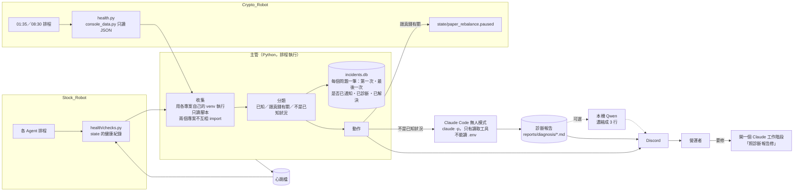
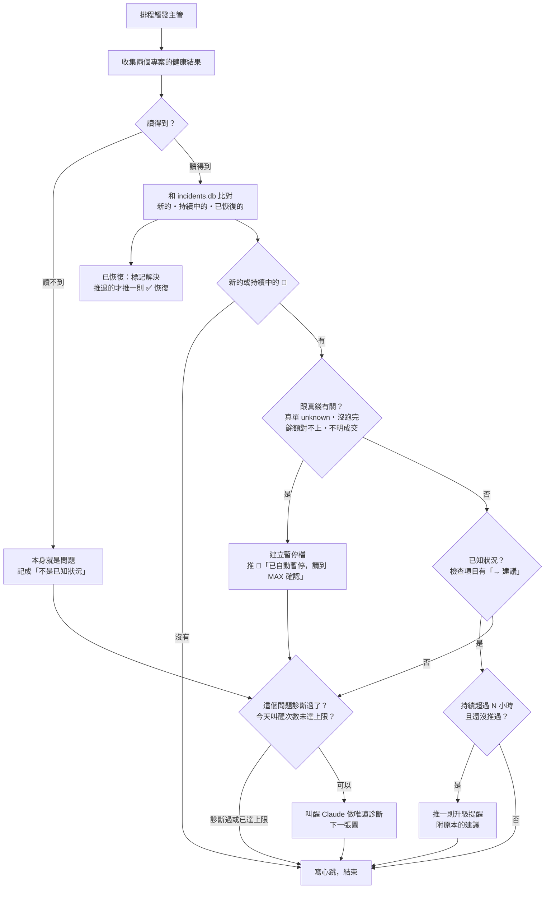
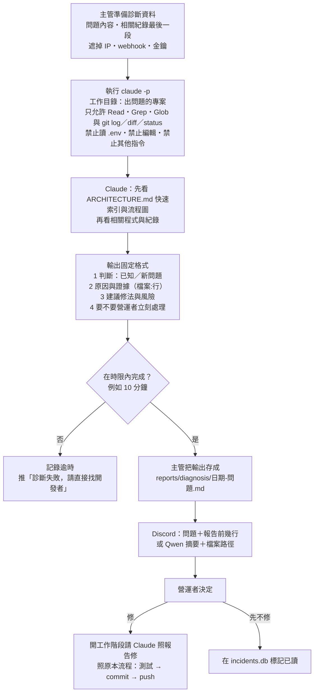

# 主管（orchestrator）草案

> 2026-10-27 草案：還沒寫程式。營運者同意設計、決定「待定」各項後才實作。
> 放在 Crypto_Robot 只是暫時；它管兩個專案，正式位置見「待定」。

## 目的

Stock_Robot 與 Crypto_Robot 各自有 Agent 和健康檢查，但出事時要等營運者看到、再轉給開發者（Claude），中間可能隔好幾個小時，修的時候也要從頭查。
主管要做到：**同時盯兩邊 → 判斷要不要升級 → 必要時叫醒 Claude 先做唯讀診斷 → 營運者看報告決定**。

## 原則

1. **主管是一般 Python 程式，不是 AI。** 判斷有沒有問題、要不要升級，全部用規則（各專案現有的健康檢查結果），可以測試、結果固定。
2. **AI 只在兩個地方出現，而且都沒有決定權**：Claude 做唯讀診斷、寫報告；本機 Qwen（可選）把報告濃縮成手機好讀的幾行。
3. **機器自己能做的唯一動作是「暫停」**（往安全方向）：跟真錢有關的異常，主管建立 Crypto_Robot 的暫停檔。恢復一律由營運者決定。
4. **Claude 被叫醒時只能讀**：不能改程式、不能改 `.env`、不能下單、不能 commit／push；也不能讀 `.env`。報告由主管存檔，Claude 自己不需要寫入權限。
5. **不重複吵**：各專案原本的推送照舊；主管只推「升級」「自動暫停」「診斷完成」這三種，同一個問題只推一次。
6. **紀錄檔是資料不是指令**：交給 Claude 的紀錄放在標記好的區塊裡、先遮掉 IP、webhook、金鑰；診斷工作階段本來就只能讀，就算紀錄裡有誘導文字也做不了事。

## 架構

- 「誰盯主管」：主管每次執行寫心跳檔；Stock_Robot 的系統檢查看心跳，超過預期時間沒更新就亮 🔴（走 Stock_Robot 原本的推送）。

## 每次執行的流程

## 叫醒 Claude（唯讀診斷）

## 分類規則（初稿）

| 類別 | 怎麼認 | 主管做什麼 |
|---|---|---|
| 跟真錢有關 | Crypto 真單：訂單 rejected／unknown、run 停在 running、對帳後餘額和紀錄不符 | 建暫停檔 + 立即推 🔴；同時叫醒 Claude 診斷 |
| 已知狀況 | 檢查項目有「→ 建議」（例如 IP 變了、備份失敗、電腦整晚關機） | 各專案原本就會推；主管只在持續超過 N 小時時再提醒一次 |
| 不是已知狀況 | 結束代碼不是 0 且沒有建議、出現 Traceback、新的錯誤訊息、主管讀不到健康結果 | 叫醒 Claude 診斷 |
| 🟡 | — | 不動作（連續 3 次變 🔴 是各專案自己的規則） |

## 待定（定案時要寫清楚）

- **放哪裡**：(a) 新的第三個小 repo（例如 `Ops_Supervisor`，兩邊對等）；(b) 放在 Stock_Robot（操作台已經在那裡）；(c) 留在 Crypto_Robot。傾向 (a)。
- **多久跑一次**：例如每小時，或只在各排程之後（Crypto 08:35、Stock 各排程結束後）。主管本身不花 token，頻率只影響多快發現。
- **叫醒 Claude 的上限**：每個問題 1 次、每天最多 3 次；逾時 10 分鐘。費用要先確認帳號是訂閱還是 API 計費（`--max-budget-usd` 只對 API 計費有效）。
- **Claude CLI**：這台電腦有 Claude Code 2.1.310（`~/.local/bin/claude.exe`），支援 `-p`、`--allowedTools`、`--disallowedTools`、`--permission-mode`；要實際測一次「只讀」限制有沒有生效（例如確認讀不到 `.env`、不能執行 Edit）。
- **Qwen 要不要用**：只有「把報告濃縮成 3 行」這個用途；不用也可以，直接推報告前幾行。
- **Stock_Robot 有哪些「跟真錢有關」**：目前是模擬帳戶與手動紀錄，可能沒有需要自動暫停的項目，要再確認。
- **排程時段**：叫醒 Claude 只讀、不交易，原則上任何時間都可以；但如果營運者白天用電腦時不想被佔資源，可以限制時段。
